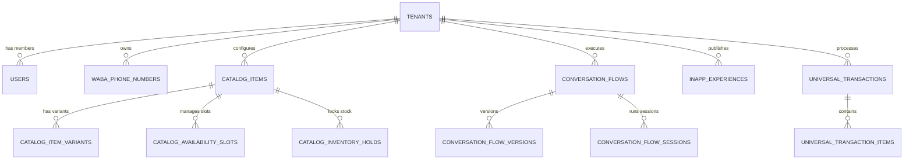

# SARVYA Platform: Master Developer & Engineering Architecture Guide

> **Confidential & Proprietary** — Engineering Documentation for Developers, Architects, and Maintainers.  
> **Platform Version:** 2.0 (Universal Multi-Sector SaaS Engine)  
> **Last Updated:** November 2026

---

## Table of Contents

1. [Executive Overview & Architectural Philosophy](#1-executive-overview--architectural-philosophy)
2. [Complete Technology Stack Reference](#2-complete-technology-stack-reference)
3. [Repository Directory & File Map](#3-repository-directory--file-map)
4. [Database Architecture & Schema Deep-Dive (96 Tables)](#4-database-architecture--schema-deep-dive-96-tables)
   - [4.1 Database Adapter Layer (`mysqlAdapter.js` & `asyncDb.js`)](#41-database-adapter-layer-mysqladapterjs--asyncdbjs)
   - [4.2 Multi-Tenancy & Audit Pattern](#42-multi-tenancy--audit-pattern)
   - [4.3 Comprehensive Table Taxonomy (14 Functional Domains)](#43-comprehensive-table-taxonomy-14-functional-domains)
5. [Backend Architecture & Request Lifecycle](#5-backend-architecture--request-lifecycle)
   - [5.1 Express Server Initialization & SPA Fallback](#51-express-server-initialization--spa-fallback)
   - [5.2 Security Headers & Upload Guards](#52-security-headers--upload-guards)
   - [5.3 Authentication, RBAC & Context Injection](#53-authentication-rbac--context-injection)
   - [5.4 Real-Time SSE (Server-Sent Events) Streaming](#54-real-time-sse-server-sent-events-streaming)
6. [Meta WhatsApp Cloud API Engine](#6-meta-whatsapp-cloud-api-engine)
   - [6.1 Multi-Line Management & Permanent System Tokens](#61-multi-line-management--permanent-system-tokens)
   - [6.2 Webhook Ingestion & Cryptographic HMAC Verification](#62-webhook-ingestion--cryptographic-hmac-verification)
   - [6.3 Template Locks, Parameter Interpolation & Live Mockup](#63-template-locks-parameter-interpolation--live-mockup)
   - [6.4 Delivery Shield & Financial Usage Ledger (Oct 2026 Rates)](#64-delivery-shield--financial-usage-ledger-oct-2026-rates)
7. [Universal Master Data Layer (ERP-Grade)](#7-universal-master-data-layer-erp-grade)
8. [Universal Commerce, Inventory & Fulfillment Engine](#8-universal-commerce-inventory--fulfillment-engine)
   - [8.1 Universal Catalog & Multi-Variant Matrix](#81-universal-catalog--multi-variant-matrix)
   - [8.2 4-Mode Availability Engine & Atomic Inventory Holds](#82-4-mode-availability-engine--atomic-inventory-holds)
   - [8.3 Dynamic Pricing & Add-On Upsell Engine](#83-dynamic-pricing--add-on-upsell-engine)
   - [8.4 Transaction Fulfillment & Inbox Commerce Drawer](#84-transaction-fulfillment--inbox-commerce-drawer)
9. [Flow Studio & Multi-Step Conversation Runtime Engine](#9-flow-studio--multi-step-conversation-runtime-engine)
   - [9.1 Graph Representation & Node Architecture](#91-graph-representation--node-architecture)
   - [9.2 Bounded O(1) LRU Runtime Cache & Trigger Router](#92-bounded-o1-lru-runtime-cache--trigger-router)
   - [9.3 Cycle-Free Hop Traversal & 18 Specialized Node Executors](#93-cycle-free-hop-traversal--18-specialized-node-executors)
   - [9.4 AI Flow Architect (Prompt-to-Graph Generation)](#94-ai-flow-architect-prompt-to-graph-generation)
   - [9.5 O(1) Pre-Aggregated Daily Funnel Analytics](#95-o1-pre-aggregated-daily-funnel-analytics)
10. [Dynamic In-App Experience Studio (`/x/:slug`)](#10-dynamic-in-app-experience-studio-xslug)
11. [Transactional Job Queue & Background Worker (`sarvya-worker`)](#11-transactional-job-queue--background-worker-sarvya-worker)
12. [Task-Scoped AI, Knowledge Grounding & Voice Copilot](#12-task-scoped-ai-knowledge-grounding--voice-copilot)
13. [Frontend Architecture & Component System](#13-frontend-architecture--component-system)
    - [13.1 React 19 + Vite 8 Build & Rollup Code Splitting](#131-react-19--vite-8-build--rollup-code-splitting)
    - [13.2 Deployment Chunk-Mismatch Auto-Recovery (`lazyWithRetry.js`)](#132-deployment-chunk-mismatch-auto-recovery-lazywithretryjs)
    - [13.3 Mobile PWA Service Worker v2 (`sw.js`)](#133-mobile-pwa-service-worker-v2-swjs)
    - [13.4 Master Page Registry (`PageSystem.jsx`)](#134-master-page-registry-pagesystemjsx)
    - [13.5 High-Density UI Primitives & `DataTable.jsx`](#135-high-density-ui-primitives--datatablejsx)
14. [Testing, Safety Directives & Quality Assurance](#14-testing-safety-directives--quality-assurance)
15. [DevOps, CI/CD & Production Deployment](#15-devops-cicd--production-deployment)
16. [Study Guide & Step-by-Step Codebase Walkthrough](#16-study-guide--step-by-step-codebase-walkthrough)

---

## 1. Executive Overview & Architectural Philosophy

**SARVYA** is an enterprise-grade, multi-tenant customer engagement, workflow automation, and conversational commerce platform built on top of the **Meta WhatsApp Cloud API (Graph v21.0)**.

Initially conceived as an automated reservation concierge for hospitality resorts, the system has undergone a comprehensive architectural transformation into a **domain-agnostic, universal multi-sector commerce & automation SaaS engine**. Today, it powers end-to-end customer operations across 8 primary business sectors:
- **Hospitality & Resorts:** Room inventory matrices, daily & seasonal rate plans, check-in greetings, amenity guides.
- **Retail & D2C:** Physical SKU inventory, multi-attribute variants (Size, Color), shipping address collection, cash-on-delivery (COD) / online payments.
- **Clinics & Healthcare:** Doctor scheduling, time-slot appointments, pre-consultation intake forms, medical reminders.
- **Salons & Wellness:** Service menus, stylist resource booking, duration-based slots, add-on treatments.
- **Restaurants & Cloud Kitchens:** Digital menu browsing, table reservations, takeaway orders, order status tracking.
- **Real Estate:** Property listings, site visit slot scheduling, brochure delivery, lead qualification.
- **Education & Coaching:** Course catalogs, demo class bookings, fee collection links, student onboarding.
- **B2B Wholesale & Agencies:** Bulk inquiries, quotation builders, payment terms negotiation, multi-client management.

### Core Architectural Pillars
1. **Zero-Markup Official Meta Cloud API:** Direct HTTP communication with Meta's Graph endpoints (`https://graph.facebook.com/v21.0/`). No reliance on third-party aggregators (Twilio, Gupshup, Wati), eliminating per-message markups and vendor latency.
2. **ERP-Grade Universal Master Data Layer:** Business masters (`locations`, `categories`, `units`, `tax_slabs`, `attributes`, `resources`, `payment_modes`) are configured once and dynamically bound to WhatsApp nodes and web screens without hardcoding.
3. **4-Mode Real-Time Availability & Atomic Holds:** Common commerce engine handling quantity-based items (`UNIT_STOCK`), overnight stays (`DATE_RANGE`), appointments (`TIME_SLOT`), and custom estimates (`QUOTE_SERVICE`) with distributed transaction safety.
4. **Sub-Millisecond Graph Traversal ($O(1)$ LRU Cache):** High-speed multi-step flow execution using pre-compiled node maps and in-memory trigger lookup tables with a hard cap of 25 hops to guarantee zero recursive looping.
5. **Universal Hybrid Bridge (WhatsApp ↔ In-App `/x/:slug`):** Seamless handoff between conversational WhatsApp chat and rich interactive web experiences with bi-directional state synchronization.
6. **Strict Safety & Mock Guardrails:** Strict programmatic prohibition against dispatching live outbound messages to external phone numbers during automated tests or local development (`isSimulation: true` / mock only).

---

## 2. Complete Technology Stack Reference

| Layer / Concern | Technology | Version | Architectural Rationale & Role |
|---|---|---|---|
| **Backend Runtime** | **Node.js** | `>= 20.x` (LTS) | Asynchronous non-blocking I/O, native worker threads, and ES2022 support. |
| **HTTP Framework** | **Express.js** | `^4.21.2` | Minimalist routing, middleware chaining, raw body preservation for HMAC. |
| **Primary Database** | **MySQL Community** | `8.4 / 8.0` | InnoDB ACID compliance, transactional `FOR UPDATE SKIP LOCKED`, JSON column support, and strict UTC audit. |
| **Database Driver** | **mysql2/promise** | `^3.24.6` | High-throughput MySQL driver with connection pooling and async/await API. |
| **Sync DB Adapter** | **`mysqlAdapter.js`** | Custom | SQLite-compatible synchronous `.prepare().run()/.get()/.all()` API implemented via worker thread synchronization for zero-refactor queries. |
| **Async DB Pool** | **`asyncDb.js`** | Custom | Native Promise pool for transactional operations (`BEGIN`, `COMMIT`, `ROLLBACK`) and atomic inventory holds. |
| **Process Manager** | **PM2** | Latest | Clustered production supervisor running API (`sarvya-api`) and background queue (`sarvya-worker`) with zero-downtime reloads. |
| **Frontend Framework**| **React** | `^19.2.8` | Modern declarative UI, Concurrent Mode, compiler optimization, React Hooks. |
| **Build Tooling** | **Vite** | `^8.3.0` | Next-generation frontend bundler, Rollup manual chunking, instant HMR. |
| **Flow Visualizer** | **@xyflow/react** | `^13.0.2` | Interactive node-based drag-and-drop visual canvas for conversation flows. |
| **Iconography** | **Lucide React** | `^1.56.0` | Lightweight SVG icons matching the unified design system. |
| **Static Linter** | **Oxlint** | `^1.81.0` | Blazing-fast Rust-based static code analyzer for React and JavaScript. |
| **Spreadsheet Engine**| **xlsx (SheetJS)**| `^0.18.5` | In-memory parsing and generation of `.xlsx` and `.csv` broadcast contact sheets. |
| **Security & Auth** | **jsonwebtoken & bcryptjs** | `^9.0.3` / `^3.0.3` | Cryptographic JWT claims, tenant scoping, and salted password hashing. |
| **Encryption** | **Node.js `crypto`** | Built-in | AES-256-GCM authenticated encryption for sensitive credentials and API tokens. |
| **Mobile PWA** | **Service Worker v2** | Custom | Offline fallback, network-first caching, immediate controller takeover (`SKIP_WAITING`). |
| **CI/CD** | **GitHub Actions** | v4 | Automated workflow running Oxlint, Vite build, MySQL 8.4 containerized QA, and zero-downtime SSH deploy. |

---

## 3. Repository Directory & File Map

```
whatsapp_bulk/
├── .github/
│   └── workflows/
│       └── ci-cd.yml                # Unified GitHub Actions CI/CD Pipeline (Build, Test, Deploy)
├── data/                            # Persistent local storage (file uploads, temporary session artifacts)
├── docs/                            # Architecture PRDs, engineering specs, and deployment guides
│   ├── CI_CD_PIPELINE.md            # Detailed SSH deploy and PM2 operational runbook
│   └── SARVYA_CONNECT_PRD.md        # Connect module product requirement document
├── frontend/                        # Modern React 19 + Vite 8 SPA Client
│   ├── public/                      # Static assets served at web root
│   │   ├── favicon.svg              # Primary SVG vector icon
│   │   ├── manifest.webmanifest     # Mobile PWA web application manifest
│   │   └── sw.js                    # Mobile PWA Service Worker v2 (Cache-busting & offline fallback)
│   ├── src/
│   │   ├── components/              # Reusable UI component library
│   │   │   ├── inapp-studio/        # In-App Experience Studio modals, screen editors & QR generators
│   │   │   ├── ui/                  # Atomic primitives: DataTable, Drawer, Modal, Tabs, Badges
│   │   │   ├── PageSystem.jsx       # Central Page Registry, breadcrumbs, lazy loader & error boundary
│   │   │   ├── Sidebar.jsx          # Collapsible operational sidebar with role-filtered navigation
│   │   │   └── Topbar.jsx           # Global search, connected WABA selector, and tenant indicators
│   │   ├── context/
│   │   │   └── AuthContext.jsx      # Global authentication state, JWT storage, and permission helpers
│   │   ├── pages/                   # 21 modular operational pages (Dashboard, Inbox, Catalog, Flows...)
│   │   ├── utils/
│   │   │   ├── apiAuth.js           # Fetch wrapper injecting JWT bearer tokens and handling 401s
│   │   │   ├── indianTime.js        # Asia/Kolkata date & time formatting utilities
│   │   │   └── lazyWithRetry.js     # React.lazy wrapper with deployment chunk-mismatch auto-recovery
│   │   ├── App.jsx                  # Root client application router and error boundary
│   │   ├── index.css                # Global CSS reset, CSS custom properties, and typography
│   │   └── main.jsx                 # Application entry point & PWA service worker registration
│   ├── package.json                 # Frontend dependencies & scripts (dev, build, lint)
│   └── vite.config.js               # Vite Rollup manual chunking and backend proxy configuration
├── public/                          # Server-served static root and public upload assets
│   └── uploads/
│       └── inbound/                 # Received customer WhatsApp media (images, voice notes, PDFs)
├── scripts/                         # Operational CLI scripts & diagnostics
│   ├── account-recovery.js          # CLI utility to recover admin accounts and reset passwords
│   ├── deploy.sh                    # Zero-downtime Linux production deployment script
│   ├── migrate-to-mysql.js          # SQLite to MySQL database data migration utility
│   ├── seed_hospitality.js          # Initial demo data seeder for hospitality resorts
│   └── test_fresh_deployment.js     # Cold-start database initialization & integrity verification
├── src/                             # Core Backend Application Source Code
│   ├── config/                      # Configuration, environment loading, and database drivers
│   │   ├── asyncDb.js               # Async Promise-based MySQL pool for transactions
│   │   ├── database.js              # Database module export, settings cache & auto-init trigger
│   │   ├── env.js                   # Environment variables parsing, JWT security guards & timezone
│   │   ├── mysqlAdapter.js          # SQLite-compatible synchronous database interface for Node.js
│   │   ├── mysqlWorker.js           # Worker thread managing synchronous MySQL executions
│   │   └── schema.js                # Master DDL with 96 table definitions, indexes & auto-migrations
│   ├── controllers/                 # Express route controllers (35 domain controllers)
│   ├── middleware/                  # Express middleware pipeline
│   │   ├── authMiddleware.js        # JWT verification, RBAC rules, and tenant context resolution
│   │   ├── rateLimiter.js           # Sliding-window rate limiters for auth, webhooks & APIs
│   │   ├── securityHeaders.js       # Production CSP, HSTS, frame protection, and XSS headers
│   │   └── uploadMiddleware.js      # Multer file upload handler with MIME validation & size limits
│   ├── routes/                      # Modular Express route declarations (20+ domain routers)
│   ├── services/                    # Business logic and domain service engines
│   │   ├── ai/                      # Task-scoped AI Agent, Gemini grounding, Voice copilot
│   │   ├── billing/                 # Meta Oct 2026 rate cards & conversation billing calculator
│   │   ├── inapp/                   # Dynamic In-App Experience Studio (/x/:slug) runtime & SSE
│   │   ├── masters/                 # ERP-grade Universal Master Data service & caching layer
│   │   ├── queue/                   # Transactional job queue engine (FOR UPDATE SKIP LOCKED)
│   │   ├── universal/               # Universal Catalog, 4-mode availability, pricing & fulfillment
│   │   ├── workflow/                # Flow Studio engine, O(1) LRU cache, trigger router & node executors
│   │   │   └── nodeExecutors/       # 18 specialized conversation node executor classes
│   │   ├── broadcastService.js      # Bulk broadcast campaign queueing and dispatching
│   │   ├── metaWhatsAppService.js   # Direct HTTP client for Meta Cloud API endpoints
│   │   ├── schedulerService.js      # Polling scheduler for due campaigns and lifecycle automations
│   │   └── webhookService.js        # Meta Webhook processing, HMAC check, and customer reply matching
│   └── utils/                       # Cryptographic utilities, QR code generators, and time helpers
├── tests/                           # Master QA and regression test suites (50+ automated test files)
│   └── master_production_qa.test.js # Master 8-stage production regression suite
├── .env.example                     # Reference environment variables documentation
├── ecosystem.config.js              # PM2 cluster configuration for API and background worker
├── package.json                     # Root dependencies, scripts (test, start, dev, db:init)
├── server.js                        # Primary Express server entry point & SPA static file host
└── worker.js                        # Dedicated background worker process entry point
```

---

## 4. Database Architecture & Schema Deep-Dive (96 Tables)

The SARVYA persistence layer is grounded in **MySQL 8.4 / 8.0** using the **InnoDB** storage engine with `utf8mb4_unicode_ci` collation. Every table is engineered to support enterprise multi-tenancy, immutable auditability, and distributed transaction safety.

### 4.1 Database Adapter Layer (`mysqlAdapter.js` & `asyncDb.js`)

To achieve maximum performance and clean separation of concerns, the backend utilizes two database interfaces:

```
                      ┌──────────────────────────────────────┐
                      │        Node.js Backend Engine        │
                      └───────┬──────────────────────┬───────┘
                              │                      │
           Synchronous Operations                    Transactional Operations
       (Read queries, single updates)            (Holds checkout, atomic payments)
                              │                      │
                              ▼                      ▼
                   ┌────────────────────┐ ┌────────────────────┐
                   │  mysqlAdapter.js   │ │     asyncDb.js     │
                   │ (Worker Thread API)│ │(Promise Pool / Txn)│
                   │  .prepare().all()  │ │ BEGIN ... COMMIT   │
                   └──────────┬─────────┘ └──────────┬─────────┘
                              │                      │
                              └──────────┬───────────┘
                                         ▼
                             ┌───────────────────────┐
                             │ MySQL 8.4 Database    │
                             │ (96 Tables / InnoDB)  │
                             └───────────────────────┘
```

1. **`mysqlAdapter.js` (Worker Thread Synchronous Adapter):**
   - Implements a synchronous prepared-statement interface mirroring `better-sqlite3`:
     ```javascript
     const stmt = db.prepare("SELECT * FROM catalog_items WHERE id = ?");
     const item = stmt.get(itemId);
     const allRows = stmt.all();
     ```
   - **Internal Mechanism:** Executes queries across an internal Node.js `worker_threads` channel using shared memory atomic wait buffers (`Atomics.wait`). This allows high-speed legacy services to query synchronously without refactoring the entire codebase into async promises.
2. **`asyncDb.js` (Native Promise Pool for ACID Transactions):**
   - Direct `mysql2/promise` connection pool used for high-concurrency, transactional workflows:
     ```javascript
     const conn = await asyncDb.getConnection();
     try {
       await conn.beginTransaction();
       // Atomic inventory verification & lock
       const [rows] = await conn.query("SELECT ... FOR UPDATE");
       // Update hold & create order
       await conn.commit();
     } catch (err) {
       await conn.rollback();
       throw err;
     } finally {
       conn.release();
     }
     ```

### 4.2 Multi-Tenancy & Audit Pattern

Every domain table in the database adheres to the standard **Audit & Multi-Tenancy Pattern**:

| Column Name | Data Type | Default / Nullability | Description |
|---|---|---|---|
| `tenant_id` | `BIGINT` | `NOT NULL DEFAULT 1` | Isolates data belonging to each SaaS organization. All queries MUST filter on `tenant_id`. |
| `active_status` | `TINYINT(1)` | `NOT NULL DEFAULT 1` | Operational state flag (`1 = Active`, `0 = Inactive / Disabled`). |
| `delete_status` | `TINYINT(1)` | `NOT NULL DEFAULT 0` | Soft-delete flag (`0 = Live`, `1 = Soft-Deleted in Recycle Bin`). |
| `deleted_at` | `DATETIME` | `DEFAULT NULL` | UTC timestamp when the record was placed in the Recycle Bin. |
| `deleted_by` | `VARCHAR(64)` | `DEFAULT NULL` | User ID / email who initiated the soft delete. |
| `created_by` | `VARCHAR(64)` | `DEFAULT NULL` | Identity of the user or system actor that created the record. |
| `updated_by` | `VARCHAR(64)` | `DEFAULT NULL` | Identity of the user or system actor that last updated the record. |
| `created_at` | `DATETIME` | `DEFAULT CURRENT_TIMESTAMP` | UTC creation timestamp. |
| `updated_at` | `DATETIME` | `DEFAULT CURRENT_TIMESTAMP ON UPDATE CURRENT_TIMESTAMP` | Automatic UTC update timestamp. |

---

### 4.3 Comprehensive Table Taxonomy (14 Functional Domains)

The database schema is structured into **96 tables** distributed across 14 functional areas:



#### Domain 1: Multi-Tenant Core & Security (7 tables)
- **`tenants`**: Core SaaS tenant account. Tracks tenant slug, subscription status, plan codes (`TRIAL`, `STARTER`, `PRO`, `ENTERPRISE`), quota limits, and custom branding JSON.
- **`tenant_subscriptions`**: Razorpay subscription tracking, billing cycles, GST invoicing amounts, and status.
- **`tenant_user_memberships`**: Maps `users` to `tenants` with specific tenant-level RBAC roles (`ADMIN`, `OPERATOR`, `AGENT`).
- **`users`**: Platform user accounts, bcrypt password hashes, global roles (`MASTER_ADMIN`, `ADMIN`, `USER`), status, and last login.
- **`password_resets`**: SHA-256 hashed password reset tokens with 1-hour expiration and single-use validation.
- **`audit_logs`**: Immutable security ledger capturing actor, action, tenant, entity type, target ID, metadata, and IP address.
- **`settings`**: Key-value platform settings table with transparent AES-256-GCM encryption for sensitive keys (`WHATSAPP_API_TOKEN`, `META_APP_SECRET`, `GEMINI_API_KEY`).

#### Domain 2: Privacy, Governance & DPDP Act 2023 (5 tables)
- **`dpdp_consent_ledger`**: Formal consent audit trail compliant with the Digital Personal Data Protection Act 2023. Stores BSUID (Business Scoped User ID), consent purpose (`MARKETING`, `SERVICE`, `TRANSACTIONAL`), notice version, and timestamp.
- **`dpdp_data_requests`**: Tracks Data Subject requests for access, correction, or erasure with automated 30-day purge scheduling.
- **`contact_consents`**: Real-time channel consent flags for customer contacts.
- **`contact_suppressions`**: Global DND (Do Not Disturb) suppression list populated automatically when customers send opt-out keywords (`STOP`, `UNSUBSCRIBE`).
- **`contact_marketing_cooldowns`**: Anti-spam cooldown intervals preventing marketing message dispatch to a recipient within 24 hours of a prior campaign.

#### Domain 3: Meta WhatsApp Cloud API Infrastructure (6 tables)
- **`waba_phone_numbers`**: Connected WhatsApp Business phone numbers, Meta Phone Number IDs, WABA IDs, quality ratings (`GREEN`, `YELLOW`, `RED`), permanent system access tokens (AES-256 encrypted), and coexistence mode toggles.
- **`templates`**: System template registry storing approved Meta templates, positional/named variable formats, headers, buttons, and languages.
- **`whatsapp_messages`**: Central message ledger tracking all inbound and outbound WhatsApp messages, Meta Message IDs (`wamid`), delivery statuses (`SENT`, `DELIVERED`, `READ`, `FAILED`), and error details.
- **`whatsapp_usage_ledger`**: Financial ledger tracking conversation charges for every message based on Meta's official category rates.
- **`incoming_webhook_events`**: Webhook idempotency ledger logging incoming event IDs to discard duplicate webhook deliveries from Meta.
- **`whatsapp_flows`**: Local cache of native Meta WhatsApp interactive flow JSON definitions and sync state.

#### Domain 4: Universal Master Data Layer (9 tables)
- **`master_domain_profiles`**: Sector blueprints (`HOSPITALITY`, `RETAIL_D2C`, `CLINIC`, `SALON`, `RESTAURANT`, `REAL_ESTATE`, `EDUCATION`, `B2B_SERVICES`).
- **`master_locations`**: Physical entities (Branches, Warehouses, Properties, Clinics, Kitchens) with address, latitude/longitude, and contact info.
- **`master_categories`**: Hierarchical category tree with parent-child relationships and sector tags.
- **`master_units`**: Unit of Measure (UOM) definitions (Piece, Kilogram, Night, Hour, Session, SqFt).
- **`master_tax_slabs`**: Standardized GST slabs (0%, 5%, 12%, 18%, 28%) and HSN/SAC codes.
- **`master_attributes`**: Variant attribute types (e.g. `Size`, `Color`, `Room Type`, `Doctor Specialization`).
- **`master_resources`**: Physical or personnel capacity units (Doctor, Stylist, Table, Conference Room, Villa).
- **`master_payment_modes`**: Supported payment methods (UPI, Card, NetBanking, COD, Payment Link).
- **`master_status_tags`**: Status taxonomy tags used across workflows and pipelines.

#### Domain 5: Universal Catalog, Availability & Pricing (9 tables)
- **`catalog_items`**: Universal commerce items/services. Holds SKU, title, domain, base rate, availability mode (`UNIT_STOCK`, `DATE_RANGE`, `TIME_SLOT`, `QUOTE_SERVICE`), and tax slab reference.
- **`catalog_categories`**: Many-to-many relationship mapping catalog items to master categories.
- **`catalog_item_variants`**: Multi-dimensional variant matrix (e.g. Size `L` + Color `Blue` or `Deluxe Sea View Room`).
- **`catalog_item_media`**: Multi-image galleries with Meta Media ID caching (`meta_media_id`, `media_url`, display order).
- **`catalog_pricing_rules`**: Dynamic pricing modifiers (seasonal adjustments, weekend surcharges, bulk volume discounts).
- **`catalog_addon_groups`**: Add-on groupings (e.g. "Airport Pickups", "Extra Bedding", "Gift Packaging").
- **`catalog_addons`**: Specific add-on items, fixed/percentage pricing, and max quantity constraints.
- **`catalog_availability_slots`**: Date and time-slot matrix tracking capacity, total allocated, and booked units.
- **`catalog_inventory_holds`**: Temporary atomic holds placed during checkout (10-minute TTL) to prevent double booking.

#### Domain 6: Universal Transactions & Orders (6 tables)
- **`universal_transactions`**: Master transaction record representing an order, reservation, appointment, or quote. Stores customer info, gross total, tax, discount, net amount, and payment status.
- **`universal_transaction_items`**: Line items within a transaction, recording item ID, variant snapshot, unit rate, tax, and selected add-ons.
- **`unified_orders` & `unified_order_items`**: High-density order records supporting legacy multi-domain cart structures.
- **`merchant_payment_configs`**: Gateway credentials (Razorpay key/secret, UPI VPA) with AES-256 encryption.
- **`merchant_payout_beneficiaries` & `merchant_payout_ledger`**: Merchant bank account verification and automated payout ledger.

#### Domain 7: Flow Studio & Multi-Step Runtime (11 tables)
- **`conversation_flows`**: Workflow definitions with trigger keywords, categories, and published version pointer.
- **`conversation_flow_versions`**: Immutable graph snapshots (`nodes_json`, `transitions_json`, `variables_json`).
- **`conversation_flow_templates`**: Pre-built system blueprints for 1-click industry flow generation.
- **`conversation_flow_sessions`**: Active conversation state for a specific sender phone, tracking current node, collected variables, and session TTL.
- **`conversation_flow_events`**: Node-level telemetry recording step entry, user inputs, and transitions.
- **`flow_node_daily_metrics`**: Incremental daily rollup table for $O(1)$ fast funnel drop-off analytics.
- **`flow_approval_requests`**: Flow governance and review requests before publishing to production.
- **`flow_preview_links`**: Cryptographically hashed shareable web preview links for flows.
- **`flow_message_templates`**: Snippets and message fragments attached to flow steps.
- **`flow_tokens` & `flow_responses`**: Authentication tokens and response storage for Meta Native Flows.

#### Domain 8: Dynamic In-App Experience Studio (`/x/:slug`) (6 tables)
- **`inapp_experiences`**: Public web experience definitions bound to clean slugs (e.g. `/x/beach-villa-booking`).
- **`inapp_screens`**: Multi-screen step sequence definitions (Catalog, Form, Custom Date Picker, Summary).
- **`inapp_form_fields`**: Interactive schema form fields with regex validation, options, and conditional logic.
- **`inapp_sessions`**: Customer web browser sessions linked to their WhatsApp phone number.
- **`inapp_rate_negotiations`**: Real-time counter-offer price bargaining between guest and sales agent.
- **`inapp_call_requests`**: Real-time "Request Callback" queue for instant voice contact.

#### Domain 9: CRM, Contacts & Shared Inbox (7 tables)
- **`contacts`**: Central contact directory with E.164 phone normalization, email, and source channel.
- **`customer_replies`**: Unified two-way inbox message repository with read receipts and SSE streaming.
- **`chat_links`**: Click-to-chat `wa.me` links with campaign tracking and pre-filled greeting text.
- **`crm_pipelines`**: Kanban pipeline configurations (e.g. "Hospitality Booking", "B2B Sales").
- **`crm_records`**: Deal cards associated with contacts, deal values, stages, and assigned agents.
- **`enquiries`**: Unassigned inbound business inquiries requiring qualification.
- **`quotes` & `quote_items`**: Formal GST quotation documents with validity dates and line items.

#### Domain 10: Broadcasts & Campaigns (4 tables)
- **`campaigns`**: Broadcast campaign headers, target template, total audience, sent/delivered counters, and scheduling.
- **`campaign_recipients`**: Individual campaign dispatch queue with personalized variable mappings and delivery status.
- **`workflow_triggers`**: Event-based automation trigger bindings.
- **`workflow_scheduled_jobs`**: Scheduled background workflow actions.

#### Domain 11: Transactional Job Queue (2 tables)
- **`system_job_queue`**: Distributed background job table with `FOR UPDATE SKIP LOCKED` concurrency.
- **`system_job_schedules`**: Recurring cron task definitions (e.g. daily metric rollups, expired hold cleanup).

#### Domain 12: AI Engine & Voice Copilot (3 tables)
- **`ai_agent_configs`**: Tenant-specific AI persona, temperature, model overrides, and permitted tools.
- **`ai_knowledge_sources`**: Text documents and FAQs chunked for grounded retrieval-augmented generation.
- **`ai_interaction_logs`**: Full audit log of AI queries, generated responses, tool calls, and token latency.

#### Domain 13: Hospitality Specialized Extensions (12 tables)
- **`properties`**, **`room_types`**, **`room_inventory_daily`**, **`daily_inventory_matrix`**: Resort physical property configuration and daily room availability.
- **`hospitality_physical_rooms`**: Specific room numbers, floors, and operational statuses (`AVAILABLE`, `MAINTENANCE`).
- **`hospitality_rate_plans`**, **`hospitality_daily_rates`**, **`hospitality_seasonal_rates`**: Meal plans (EP, CP, MAP), seasonal pricing, and extra bed charges.
- **`hospitality_tax_rules`**, **`hospitality_inventory_blocks`**, **`hospitality_room_images`**, **`hospitality_policies`**, **`hospitality_facilities`**, **`hospitality_faqs`**, **`hospitality_chat_sessions`**: Specialized resort guest service data.

#### Domain 14: Automated Lifecycle Automations (2 tables)
- **`automated_booking_contacts`** & **`automated_booking_dispatches`**: Timed guest journeys (e.g. Driving directions 24h before check-in, WiFi credentials at arrival, Review request 2h after checkout).

---

## 5. Backend Architecture & Request Lifecycle

### 5.1 Express Server Initialization & SPA Fallback

The backend application is orchestrated in [server.js](file:///d:/whatsapp_bulk/server.js). The HTTP pipeline is configured in strict sequential order:

```
[Inbound Request]
       │
       ▼
1. Security Headers Middleware (CSP, HSTS, Frameguard, Referrer-Policy, nosniff)
       │
       ▼
2. CORS Validation (Origin whitelisting with credentials support)
       │
       ▼
3. Request Body Parsers (express.json limit: 50MB with req.rawBody preservation)
       │
       ▼
4. Static Asset Middleware (Vite frontend/dist with Cache-Control headers)
       │
       ▼
5. Upload Path Traversal Guard (/uploads traversal defense & dangerous file extensions block)
       │
       ▼
6. Modular API Routes (/api/auth, /api/masters, /api/flows, /api/inbox, /webhook)
       │
       ▼
7. SPA Fallback (app.get('*'))
       ├── If /assets/* or static file ext missing: Return 404 text/plain (Prevents HTML MIME errors)
       └── If navigation route: Serve frontend/dist/index.html (no-cache)
       │
       ▼
8. Global Sanitized Error Handler (Transforms errors into JSON; hides production stack traces)
```

#### Missing Static Asset 404 Defense
A critical architectural pattern implemented in `server.js` prevents SPA routers from breaking ES module chunk loaders:
```javascript
// server.js - SPA fallback
app.get("*", (req, res) => {
  // If request is for an asset, script, style, image, or font that doesn't exist, NEVER return index.html!
  // Return 404 so browsers fail cleanly and client-side chunk recovery can trigger.
  if (
    req.path.startsWith("/assets/") ||
    /\.(js|mjs|css|map|wasm|json|png|jpg|jpeg|gif|svg|ico|webp|woff|woff2|ttf|eot)$/i.test(req.path)
  ) {
    res.setHeader("Cache-Control", "no-cache, no-store, must-revalidate");
    return res.status(404).type("text/plain").send("Asset not found");
  }

  // Normal client-side SPA navigation routes
  res.setHeader("Cache-Control", "no-cache, no-store, must-revalidate");
  res.sendFile(path.join(distPath, "index.html"));
});
```

### 5.2 Security Headers & Upload Guards

1. **Strict Content Security Policy (`src/middleware/securityHeaders.js`):**
   - Configured with `script-src 'self' 'unsafe-inline'`, `style-src 'self' 'unsafe-inline' https://fonts.googleapis.com`, `font-src 'self' https://fonts.gstatic.com data:`, and `connect-src 'self' https://fonts.googleapis.com https://fonts.gstatic.com`.
2. **Upload Traversal Defense (`server.js`):**
   - Every request to `/uploads` is inspected: URL decoding is applied, directory climbing (`..` and `\`) is forbidden, and execution of dangerous extensions (`.svg`, `.html`, `.js`, `.exe`, `.bat`, `.sh`, `.php`) is blocked with HTTP 403 Forbidden.

### 5.3 Authentication, RBAC & Context Injection

Authentication is governed by [src/middleware/authMiddleware.js](file:///d:/whatsapp_bulk/src/middleware/authMiddleware.js):
- **Bearer Token Resolution:** Inspects `Authorization: Bearer <token>` header, falling back to query param `?token=` for SSE streams where headers cannot be set natively.
- **Tenant Context Injection:** Decodes JWT claims and injects `req.user`:
  ```javascript
  req.user = {
    userId: decoded.userId,
    email: decoded.email,
    role: decoded.role,           // MASTER_ADMIN | ADMIN | USER
    tenantId: decoded.tenantId,   // SaaS organization boundary
    impersonating: decoded.impersonating || false
  };
  ```
- **Permission Guards:** Helper middlewares enforce role boundaries:
  - `requireAdmin`: Enforces `role === 'ADMIN' || role === 'MASTER_ADMIN'`.
  - `requireMasterAdmin`: Restricts access exclusively to the root platform owner (`role === 'MASTER_ADMIN'`).

### 5.4 Real-Time SSE (Server-Sent Events) Streaming

For live updates across the Inbox, Campaign Progress, and In-App Studio, SARVYA utilizes native **Server-Sent Events (SSE)** rather than heavy WebSocket connections:
- Endpoint: `GET /api/inbox/stream?token=<jwt>`
- **Headers Sent:**
  ```http
  Content-Type: text/event-stream
  Cache-Control: no-cache, no-transform
  Connection: keep-alive
  X-Accel-Buffering: no
  ```
- **Connection Management:** Every active response stream is stored in an in-memory client `Set`. A 25-second heartbeat comment (`: ping\n\n`) is broadcast to prevent proxy timeouts.
- **Targeted Dispatch:** When a new inbound message arrives, the webhook handler broadcasts an SSE event containing the normalized conversation payload directly to clients subscribed to that tenant.

---

## 6. Meta WhatsApp Cloud API Engine

### 6.1 Multi-Line Management & Permanent System Tokens

SARVYA connects directly to Meta's Cloud API without intermediaries. Organizations can register multiple phone lines under one or more WhatsApp Business Account (WABA) IDs:
- **Token Security:** Tokens are encrypted in the database using **AES-256-GCM** via [src/utils/cryptoUtil.js](file:///d:/whatsapp_bulk/src/utils/cryptoUtil.js). Plaintext tokens are never stored in SQL tables.
- **Coexistence Mode:** Supports Meta's coexistence feature allowing a number to be used on the physical WhatsApp Business mobile app and Cloud API concurrently.
- **Line Registration:** Implements Meta's 2-step verification registration API (`POST /{phone_number_id}/register`) with customer-supplied 6-digit PINs.

### 6.2 Webhook Ingestion & Cryptographic HMAC Verification

Meta sends real-time webhook notifications for inbound messages, delivery receipts, and flow submissions. Ingestion is handled in [src/services/webhookService.js](file:///d:/whatsapp_bulk/src/services/webhookService.js):
1. **Verification Challenge (`GET /webhook`):** Validates `hub.mode === 'subscribe'` and matches `hub.verify_token` against the tenant's configured verify token, responding with `hub.challenge`.
2. **Cryptographic HMAC-SHA256 Signature (`POST /webhook`):**
   - Meta signs every webhook payload with the app's secret in the `X-Hub-Signature-256` header.
   - The server validates the signature using the raw unparsed request buffer (`req.rawBody`):
     ```javascript
     const expectedSignature = 'sha256=' + crypto
       .createHmac('sha256', appSecret)
       .update(req.rawBody)
       .digest('hex');
     if (!crypto.timingSafeEqual(Buffer.from(signature), Buffer.from(expectedSignature))) {
       return res.status(403).send('Invalid signature');
     }
     ```
3. **Idempotency & Deduplication:** Every incoming `entry[].changes[].value.messages[].id` is verified against `incoming_webhook_events`. Duplicates are acknowledged with HTTP 200 immediately to prevent re-processing.
4. **Message Parsing & Ingestion:**
   - Normalizes text messages, interactive button replies, list selections, media (images, audio, documents), locations, and Flow responses.
   - For media messages, queries Meta's media retrieval endpoint (`GET /{media_id}`), downloads the binary stream, stores it securely under `public/uploads/inbound/`, and generates a local accessible URL.

### 6.3 Template Locks, Parameter Interpolation & Live Mockup

1. **Parameter Formats:** Supports both Meta **Positional parameters** (`{{1}}`, `{{2}}`) and modern **Named parameters** (`{{name}}`, `{{checkin_date}}`).
2. **Template Lock Protection:** When a broadcast campaign is scheduled or in progress, the referenced template is flagged with a **409 Conflict Lock**. Edits or deletions of the template are forbidden until the campaign concludes.
3. **Interactive Mockup Engine:** Frontend renders a pixel-perfect smartphone preview interpolating recipient Excel data in real time with interactive button previews.

### 6.4 Delivery Shield & Financial Usage Ledger (Oct 2026 Rates)

- Implements Meta's official conversation category pricing (Marketing, Utility, Authentication, Service).
- **Free Service Window Tracking:** Automatically flags 24-hour customer care windows opened by user-initiated messages.
- **Error 131049 Delivery Shield:** Traps Meta rate-limiting and spam rejections (`error_code: 131049`), automatically waiving charges in the ledger and triggering backoff throttling.

---

## 7. Universal Master Data Layer (ERP-Grade)

The Universal Master Data layer ([src/services/masters/masterDataService.js](file:///d:/whatsapp_bulk/src/services/masters/masterDataService.js)) abstracts business configurations into 7 core master entities:

```
┌────────────────────────────────────────────────────────────────────────┐
│                   Universal Master Data Layer                          │
├─────────────────┬──────────────────┬─────────────────┬─────────────────┤
│ master_locations│master_categories │  master_units   │master_tax_slabs │
│ (Branches/Villas│ (Catalog Tree /  │ (Pcs, Kg, Night,│ (GST 0%, 5%,    │
│  Clinics/Tables)│  Specialties)    │  Hour, Session) │  12%, 18%, 28%) │
├─────────────────┴──────────────────┴─────────────────┴─────────────────┤
│ master_attributes     │ master_resources       │ master_payment_modes  │
│ (Size, Color, Tiers)  │ (Doctor, Stylist, Room)│ (UPI, Card, COD, Link)│
└────────────────────────────────────────────────────────────────────────┘
```

### Key Operations & Capabilities
- **Single Source of Truth:** Business admins configure locations, categories, units, and tax slabs once in the Masters Hub.
- **Dynamic Node Binding:** Conversation flow nodes and In-App screens reference master IDs (`master_location_id`, `master_category_id`). When branches expand or tax rates change, the changes propagate automatically to all flows and screens with zero code edits.
- **Bounded Master Cache (`masterCacheService.js`):** In-memory Map cache with a 5-minute TTL guarantees that master queries during high-volume chat routing execute in $< 1\text{ms}$.

---

## 8. Universal Commerce, Inventory & Fulfillment Engine

The universal commerce layer powers transactions across physical retail, service appointments, hospitality bookings, and custom quotations from a single code path.

### 8.1 Universal Catalog & Multi-Variant Matrix

- Implemented in [src/services/universal/universalCatalogService.js](file:///d:/whatsapp_bulk/src/services/universal/universalCatalogService.js).
- **Data Model:** `catalog_items` acts as the root SKU definition, linked to `catalog_item_variants` for multi-dimensional options (e.g. Size `M` + Color `Red`, or Room `Deluxe` + Meal `CP`).
- **Media Gallery & Meta Media ID Caching:** Multi-image gallery in `catalog_item_media`. When an item image is dispatched over WhatsApp for the first time, its generated `meta_media_id` is cached in MySQL. Subsequent dispatches reuse the cached ID, reducing latency and eliminating redundant asset uploads to Meta.

### 8.2 4-Mode Availability Engine & Atomic Inventory Holds

The availability engine ([src/services/universal/universalAvailabilityService.js](file:///d:/whatsapp_bulk/src/services/universal/universalAvailabilityService.js)) supports 4 distinct commercial models:

```
                     ┌───────────────────────────────────┐
                     │     4-Mode Availability Engine    │
                     └─────────────────┬─────────────────┘
                                       │
         ┌──────────────────┬──────────┴──────────┬──────────────────┐
         ▼                  ▼                     ▼                  ▼
   [UNIT_STOCK]       [DATE_RANGE]           [TIME_SLOT]      [QUOTE_SERVICE]
   Physical Goods     Overnight Stays        Appointments     Custom Services
   (Inventory count)  (Continuous Nights)    (Start/End Time) (Manual Estimates)
```

1. **`UNIT_STOCK`:** Decrements physical stock counters. Checks `stock_quantity - locked_holds > 0`.
2. **`DATE_RANGE`:** Evaluates continuous nightly availability between `check_in_date` and `check_out_date` against `catalog_availability_slots` and `hospitality_inventory_blocks`.
3. **`TIME_SLOT`:** Verifies capacity for discrete appointment intervals (e.g. `10:00 - 10:30`) against available `master_resources` (doctors, stylists).
4. **`QUOTE_SERVICE`:** Open availability mode for high-value services requiring personalized quotation creation.

#### Atomic Holds (`catalog_inventory_holds`)
When a customer initiates checkout in WhatsApp or an In-App screen, the system creates an atomic hold:
- **Lock Window:** Default 10-minute TTL (`expires_at = UTC_TIMESTAMP() + INTERVAL 10 MINUTE`).
- **Race-Condition Safety:** Placed using `asyncDb` inside an InnoDB transaction with `SELECT ... FOR UPDATE`. If stock or slot capacity is exhausted, the hold creation is rejected atomically with HTTP 422.
- **Auto-Cleanup:** The background worker (`sarvya-worker`) scans and expires unconfirmed holds every 60 seconds, returning inventory to the available pool.

### 8.3 Dynamic Pricing & Add-On Upsell Engine

- **Dynamic Pricing Engine (`universalPricingService.js`):** Evaluates base rates against active rules in `catalog_pricing_rules` (seasonal multipliers, weekend rates, promo codes, and quantity thresholds).
- **Add-On Packaging:** Items can link to `catalog_addon_groups` (e.g., Breakfast Buffet, Airport Transfer, Extended Warranty). Add-ons can be marked as mandatory, optional, or multi-quantity.

### 8.4 Transaction Fulfillment & Inbox Commerce Drawer

- **Fulfillment Engine (`universalFulfillmentService.js`):** Converts an atomic hold into a confirmed `universal_transactions` record inside an InnoDB transaction.
- **Deposit & Payment Rails:** Collects full payment or partial deposits via `master_payment_modes` (UPI QR, Razorpay link, COD).
- **GST Invoicing:** Automatically calculates CGST, SGST, or IGST based on location jurisdictions and generates compliant invoice numbers.
- **Inbox Commerce Drawer:** Customer support agents viewing a conversation in `InboxPage.jsx` can open the slide-out Commerce Drawer to view live cart holds, generate instant payment links, or manually confirm bookings with 1 click.

---

## 9. Flow Studio & Multi-Step Conversation Runtime Engine

The Flow Studio enables building complex, branching WhatsApp auto-reply bots and interactive forms using a visual drag-and-drop canvas.

### 9.1 Graph Representation & Node Architecture

A conversation flow graph is stored in `conversation_flow_versions` as three JSON schemas:
- **`nodes_json`**: Array of node definitions with unique IDs, types, labels, positions `(x, y)`, and configuration payloads.
- **`transitions_json`**: Edges connecting nodes with source handle, target handle, and evaluation conditions.
- **`variables_json`**: Declared session variables (e.g. `guest_name`, `num_guests`, `selected_date`, `cart_total`).

### 9.2 Bounded O(1) LRU Runtime Cache & Trigger Router

To ensure that incoming WhatsApp messages are routed in $< 2\text{ms}$, the runtime relies on [src/services/workflow/runtimeCache.js](file:///d:/whatsapp_bulk/src/services/workflow/runtimeCache.js):
- **LRU Cache Implementation:** Zero-dependency Least-Recently-Used cache built with native JavaScript `Map` eviction order.
  - `maxFlows = 200`: Caches pre-compiled graph objects `{ nodeMap: Map<id, Node>, outgoingMap: Map<sourceId, Edge[]>, startNodeId }`.
  - `maxTriggerIndices = 100`: Caches per-tenant keyword trigger indexes.
  - `TTL = 5 minutes`: Automatic eviction of stale flow graphs.
- **$O(1)$ Trigger Router (`workflowTriggerService.js`):** Exact and normalized keyword lookups execute in $O(1)$ time without scanning SQL tables.

### 9.3 Cycle-Free Hop Traversal & 18 Specialized Node Executors

When a message is received, [src/services/workflow/conversationFlowEngine.js](file:///d:/whatsapp_bulk/src/services/workflow/conversationFlowEngine.js) executes the graph:
- **Hard Hop Cap:** Hard limit of `MAX_HOPS = 25` per turn. If a path exceeds 25 hops without waiting for user input, execution halts immediately with a loop warning to prevent infinite execution cycles.
- **Session State:** Persisted in `conversation_flow_sessions` with collected variables and current node pointer.

#### The 18 Specialized Node Executors (`src/services/workflow/nodeExecutors/`):
1. **`messageExecutor.js`**: Sends text, markdown, or media messages with dynamic variable interpolation.
2. **`templateExecutor.js`**: Dispatches approved Meta templates with positional or named parameters.
3. **`intakeExecutor.js`**: Prompts the customer and waits for user text, email, phone, or location input.
4. **`conditionExecutor.js`**: Evaluates multi-branch expressions (`>`, `<`, `==`, `CONTAINS`, `REGEX`) via safe parser.
5. **`variableExecutor.js`**: Performs in-memory arithmetic and variable assignments.
6. **`webhookExecutor.js`**: Executes external HTTP requests (GET/POST/PUT) with configurable timeouts and headers.
7. **`whatsappFlowExecutor.js`**: Dispatches native Meta WhatsApp interactive forms and captures responses.
8. **`catalogBrowserExecutor.js`**: Dynamically queries the Universal Catalog and sends interactive multi-item carousel cards.
9. **`catalogBookingExecutor.js`**: Validates 4-mode availability and acquires an atomic inventory hold.
10. **`addonQuoteExecutor.js`**: Displays add-on options and calculates live price estimates.
11. **`inappBridgeExecutor.js`**: Generates a secure, single-use In-App link (`/x/:slug?session=...`) for deep-link handoff.
12. **`masterPickerExecutor.js`**: Dynamically generates interactive WhatsApp list buttons from Universal Masters (e.g. Branch locations).
13. **`crmUpsertExecutor.js`**: Creates or updates contacts and deal stages in CRM pipelines.
14. **`aiReplyExecutor.js`**: Generates task-scoped AI conversational answers using tenant knowledge grounding.
15. **`aiHybridExecutor.js`**: Hybrid node attempting structured intent recognition first, falling back to grounded AI.
16. **`handoffExecutor.js`**: Pauses automated flow execution and assigns conversation to human agent in `InboxPage`.
17. **`delayExecutor.js`**: Schedules delayed workflow resumes via `sarvya-worker`.
18. **`endExecutor.js`**: Closes the conversation session and flushes state.

### 9.4 AI Flow Architect (Prompt-to-Graph Generation)

Admins can generate complete multi-step flows using plain English or Hinglish prompts (e.g., *"Create a clinic appointment booking flow for our dental branch with doctor selection and confirmation"*):
- Service: [src/services/workflow/aiFlowGeneratorService.js](file:///d:/whatsapp_bulk/src/services/workflow/aiFlowGeneratorService.js)
- **Context Injection:** Injects current tenant branches, catalog items, and tax slabs via `aiFlowContextBuilder.js`.
- **Validation:** Generated graphs are validated for connectivity, unreachable nodes, and transition integrity before presentation in Flow Studio.

### 9.5 O(1) Pre-Aggregated Daily Funnel Analytics

- Telemetry events are stored in `conversation_flow_events`.
- To prevent heavy `GROUP BY` full-table scans when admins view analytics dashboards, the background worker continuously rolls up counts into `flow_node_daily_metrics`.
- Funnel queries read directly from daily rollups in $< 50\text{ms}$.

---

## 10. Dynamic In-App Experience Studio (`/x/:slug`)

The In-App Experience Studio allows businesses to offer mobile web experiences for complex interactions that exceed WhatsApp's text interface (e.g. room image carousels, interactive floorplans, customized date-range calendars, or multi-step checkout):
- **Admin Access Protection:** Studio creation, editing, and screen/field schema management are protected by `requireAdmin` backend middleware and tagged `adminOnly: true` in the frontend navigation registry. Non-admin users cannot access the studio.
- **Clean URLs:** Mapped to vanity paths: `https://survya.flex-us.in/x/{slug}`.
- **Bi-Directional Bridge:** When a user transitions from WhatsApp to `/x/:slug`, the session token hydrates the web view with their phone number and cart context.
- **Live Rate Negotiation:** Customers can submit counter-offers on quotes; sales agents receive instant alerts in `InboxPage` and can accept or counter in real time.
- **Callback Queue:** Integrated "Request Call" button queues an urgent callback in `inapp_call_requests` for front-desk agents.

---

## 11. Transactional Job Queue & Background Worker (`sarvya-worker`)

Background tasks are decoupled from the HTTP server and processed by a dedicated worker process ([worker.js](file:///d:/whatsapp_bulk/worker.js)):

```
┌────────────────────────────────────────────────────────────────────────┐
│                   MySQL system_job_queue Table                         │
│  [Job: SEND_BROADCAST] [Job: EXPIRE_HOLDS] [Job: SYNC_INDIAMART]       │
└───────────────────────────────────┬────────────────────────────────────┘
                                    │
                  SELECT ... FOR UPDATE SKIP LOCKED
                                    │
                                    ▼
┌────────────────────────────────────────────────────────────────────────┐
│                   sarvya-worker (worker.js)                            │
│  - Concurrency Pool (4 concurrent jobs)                                │
│  - Exponential Backoff Retry (1s, 4s, 16s, 64s)                        │
│  - Dead-Letter Queue (Status: FAILED after max retries)                │
└────────────────────────────────────────────────────────────────────────┘
```

### Concurrency Model & Guarantees
- **`FOR UPDATE SKIP LOCKED`:** Multiple worker processes or threads can poll the job queue simultaneously without lock contention or duplicate execution.
- **Exponential Backoff:** Transient failures (e.g. Meta 5xx network glitches) retry with exponential backoff delays.
- **Scheduled Maintenance Jobs:**
  - `EXPIRE_STALE_HOLDS`: Runs every 60s; releases inventory holds past their 10-minute TTL.
  - `ROLLUP_DAILY_METRICS`: Runs every 5m; aggregates flow telemetry into daily metrics.
  - `PRUNE_OLD_LOGS`: Runs daily; purges raw events older than 90 days.

---

## 12. Task-Scoped AI, Knowledge Grounding & Voice Copilot

The AI engine ([src/services/ai/taskScopedAiAgentService.js](file:///d:/whatsapp_bulk/src/services/ai/taskScopedAiAgentService.js)) powers intelligent conversational capabilities grounded strictly in business knowledge:
- **Task Scoping:** AI agents are restricted to authorized operational boundaries (e.g. Concierge, Booking Assistant). System instructions strictly prohibit off-topic hallucinations.
- **Knowledge Base RAG (`knowledgeRetrievalService.js`):** Queries `ai_knowledge_sources` using keyword-weighted semantic matching to inject verified business policies, operating hours, and menus into prompt context.
- **Voice Transcription Copilot (`voiceTranscriptionService.js`):** Incoming customer WhatsApp voice notes (`.ogg` / opus) are transcribed into text and summarized for inbox agents.
- **IndiaMART & Meta CAPI Sync:** Automatically imports external marketplace leads and reports offline conversion events back to Meta Conversions API (CAPI) for ROAS tracking.

---

## 13. Frontend Architecture & Component System

The frontend is a high-performance **Single Page Application (SPA)** built with **React 19** and **Vite 8**.

### 13.1 React 19 + Vite 8 Build & Rollup Code Splitting

Configured in [frontend/vite.config.js](file:///d:/whatsapp_bulk/frontend/vite.config.js):
- **Targeted Manual Chunks:**
  ```javascript
  manualChunks(id) {
    if (id.includes('node_modules/react') || id.includes('node_modules/react-dom')) return 'vendor-react';
    if (id.includes('node_modules/@xyflow') || id.includes('node_modules/reactflow')) return 'vendor-xyflow';
    if (id.includes('node_modules/lucide-react')) return 'vendor-icons';
  }
  ```
  Isolates massive core libraries from business logic, ensuring rapid subsequent builds and optimal HTTP caching.

### 13.2 Deployment Chunk-Mismatch Auto-Recovery (`lazyWithRetry.js`)

When new frontend builds are deployed to production, older browser tabs requesting outdated hashed chunks (`BookingsOrdersPage-[oldhash].js`) encounter `ChunkLoadError` or `MIME type text/html` failures.
- Utility: [frontend/src/utils/lazyWithRetry.js](file:///d:/whatsapp_bulk/frontend/src/utils/lazyWithRetry.js)
- **Automatic Recovery:**
  ```javascript
  export function lazyWithRetry(componentImport) {
    return lazy(async () => {
      try {
        return await componentImport();
      } catch (error) {
        if (isChunkError && typeof window !== 'undefined') {
          const lastReload = sessionStorage.getItem('sarvya_chunk_reload');
          const now = Date.now();
          if (!lastReload || now - Number(lastReload) > 15000) {
            sessionStorage.setItem('sarvya_chunk_reload', String(now));
            window.location.reload();
            return new Promise(() => {});
          }
        }
        throw error;
      }
    });
  }
  ```
- **Error Boundary Fallback:** If automatic reload is bypassed, `PageErrorBoundary` renders a dedicated **"New Release Available"** card with a 1-click reload button.

### 13.3 Mobile PWA Service Worker v2 (`sw.js`)

- **Cache Version:** `sarvya-cache-v2`.
- **Immediate Takeover:** Listens for `SKIP_WAITING` message and claims clients immediately (`self.clients.claim()`).
- **Network-First Navigation:** HTML navigation requests always fetch fresh with `{ cache: 'no-cache' }` so users immediately receive updated bundle hashes.
- **404 Asset Defense:** Missing `/assets/` requests return 404 rather than falling back to cached root HTML.

### 13.4 Master Page Registry (`PageSystem.jsx`)

All 21 sidebar navigation tabs are governed centrally in [frontend/src/components/PageSystem.jsx](file:///d:/whatsapp_bulk/frontend/src/components/PageSystem.jsx):
- Each tab declares its ID, title, module, group, badge, Lucide icon, description, `adminOnly` flag, and code-split component.
- **Admin Control Section:** `admin`, `autoreply`, `flowStudio`, `inapp_studio`, `payouts`, and `connect` are classified under **System Administration** and flagged `adminOnly: true`. If a non-admin user navigates to an admin-only tab or deep link, `PageSystem` automatically redirects them to the overview dashboard.
- Automatically handles deep-linking, browser tab title updates (`usePageMeta`), and contextual sibling navigation pills.

### 13.5 High-Density UI Primitives & `DataTable.jsx`

- Reusable table component ([frontend/src/components/ui/DataTable.jsx](file:///d:/whatsapp_bulk/frontend/src/components/ui/DataTable.jsx)) supporting density modes (`compact` | `comfortable`), sticky headers, sorting, search filtering, pagination, and multi-arg render functions `(cellValue, row)`.

---

## 14. Testing, Safety Directives & Quality Assurance

> [!CAUTION]
> ### PERMANENT SAFETY DIRECTIVE: ZERO LIVE WHATSAPP MESSAGES
> All automated tests, QA verification scripts, and local development runs MUST strictly use mock adapters or sandbox stubs (`isSimulation: true`).  
> **Under no circumstances may automated scripts call live Meta Graph API message endpoints (`POST /{phone_number_id}/messages`) to deliver live messages to external phone numbers.**

### Test Suites (`tests/`)
The platform includes extensive automated unit, integration, and regression suites:
- **`master_production_qa.test.js`**: Master 8-stage regression suite:
  1. Multi-Tenant Auth & RBAC Isolation
  2. Admin Full CRUD & Recycle Bin Governance
  3. Meta Connect & Messaging Guardrails (409 lock, 422 window, 403 opt-out)
  4. Flow Studio & AI Architect (valid graphs, zero looping)
  5. In-App Experience Runtime (field validation, price negotiation)
  6. Job Queue Concurrency (`FOR UPDATE SKIP LOCKED`, retry backoff)
  7. Task-Scoped AI & Lead Attribution (grounding, IndiaMART sync)
  8. DPDP Act 2023 Compliance & SEO (consent ledger, PII anonymization)
- **`test_fresh_deployment.js`**: Cold-start deployment script creating a blank database, executing `schema.js`, and asserting that all 96 tables and initial seed data initialize cleanly.

---

## 15. DevOps, CI/CD & Production Deployment

### 15.1 GitHub Actions CI/CD Pipeline (`.github/workflows/ci-cd.yml`)

The pipeline runs automatically on push/PR to `main`:
1. **`frontend-build`**: Sets up Node 20.x, runs Oxlint, compiles Vite assets (`npm --prefix frontend run build`), and verifies build artifacts.
2. **`backend-test`**: Boots a containerized **MySQL 8.4** service, validates auto-migrations, runs `test_fresh_deployment.js`, and executes `master_production_qa.test.js`.
3. **`deploy`**: Upon successful test completion on `main`, securely connects to the production VPS via SSH, executes git pull, rebuilds assets, runs `pm2 reload ecosystem.config.js --update-env`, and performs an HTTP health probe.

### 15.2 PM2 Process Architecture (`ecosystem.config.js`)

In production, PM2 manages two distinct application instances:
- **`sarvya-api`**: Main Express HTTP server (`server.js`) on port 5000 with graceful shutdown timeout of 5s.
- **`sarvya-worker`**: Dedicated background job processor (`worker.js`) with shutdown timeout of 10s.

```bash
# Production PM2 Management Commands
pm2 status                       # View live process statuses and memory usage
pm2 reload ecosystem.config.js  # Zero-downtime rolling reload
pm2 logs sarvya-api             # Stream real-time HTTP server logs
pm2 logs sarvya-worker          # Stream background job queue logs
pm2 monit                       # Real-time terminal CPU/Memory monitor
```

### 15.3 Standalone Linux Deployment Script (`scripts/deploy.sh`)

A safe deployment bash script is available on the server:
```bash
chmod +x scripts/deploy.sh
./scripts/deploy.sh
```

---

## 16. Study Guide & Step-by-Step Codebase Walkthrough

To quickly master the SARVYA architecture, follow this recommended study sequence:

### Day 1: Core Foundation & Database
1. Read **[src/config/env.js](file:///d:/whatsapp_bulk/src/config/env.js)** to understand environment loading, security constants, and timezone handling.
2. Read **[src/config/schema.js](file:///d:/whatsapp_bulk/src/config/schema.js)** to understand the 96 tables and the multi-tenancy audit pattern.
3. Inspect **[src/config/mysqlAdapter.js](file:///d:/whatsapp_bulk/src/config/mysqlAdapter.js)** and **[src/config/asyncDb.js](file:///d:/whatsapp_bulk/src/config/asyncDb.js)** to master synchronous vs transactional database querying.

### Day 2: Server Pipeline & Meta Integration
1. Follow the request lifecycle in **[server.js](file:///d:/whatsapp_bulk/server.js)** from middleware down to SPA fallback.
2. Study **[src/middleware/authMiddleware.js](file:///d:/whatsapp_bulk/src/middleware/authMiddleware.js)** for JWT resolution and RBAC guards.
3. Read **[src/services/webhookService.js](file:///d:/whatsapp_bulk/src/services/webhookService.js)** and **[src/services/metaWhatsAppService.js](file:///d:/whatsapp_bulk/src/services/metaWhatsAppService.js)** to understand Meta Graph API calls and HMAC webhook verification.

### Day 3: Master Data & Universal Commerce
1. Explore **[src/services/masters/masterDataService.js](file:///d:/whatsapp_bulk/src/services/masters/masterDataService.js)** to see how ERP-grade masters are cached and fetched.
2. Review **[src/services/universal/universalCatalogService.js](file:///d:/whatsapp_bulk/src/services/universal/universalCatalogService.js)** and **[src/services/universal/universalAvailabilityService.js](file:///d:/whatsapp_bulk/src/services/universal/universalAvailabilityService.js)** for the 4 availability modes and atomic holds.
3. Study **[src/services/universal/universalFulfillmentService.js](file:///d:/whatsapp_bulk/src/services/universal/universalFulfillmentService.js)** for transactional order creation and invoicing.

### Day 4: Workflow Engine & Flow Studio
1. Read **[src/services/workflow/conversationFlowEngine.js](file:///d:/whatsapp_bulk/src/services/workflow/conversationFlowEngine.js)** to see how graphs are traversed with a 25-hop limit.
2. Inspect the 18 executors in **[src/services/workflow/nodeExecutors/](file:///d:/whatsapp_bulk/src/services/workflow/nodeExecutors/)** to understand how each node type executes.
3. Review **[src/services/workflow/runtimeCache.js](file:///d:/whatsapp_bulk/src/services/workflow/runtimeCache.js)** for the bounded $O(1)$ LRU cache.

### Day 5: Frontend SPA & Background Worker
1. Study **[worker.js](file:///d:/whatsapp_bulk/worker.js)** and **[src/services/queue/jobWorkerEngine.js](file:///d:/whatsapp_bulk/src/services/queue/jobWorkerEngine.js)** for distributed MySQL job queue polling.
2. Inspect **[frontend/src/components/PageSystem.jsx](file:///d:/whatsapp_bulk/frontend/src/components/PageSystem.jsx)** and **[frontend/src/utils/lazyWithRetry.js](file:///d:/whatsapp_bulk/frontend/src/utils/lazyWithRetry.js)** for code-splitting and chunk-recovery.
3. Review **[frontend/public/sw.js](file:///d:/whatsapp_bulk/frontend/public/sw.js)** for PWA service worker caching and update mechanics.

---

*End of Developer Master Architecture Guide. Document maintained by the SARVYA Core Platform Team.*

