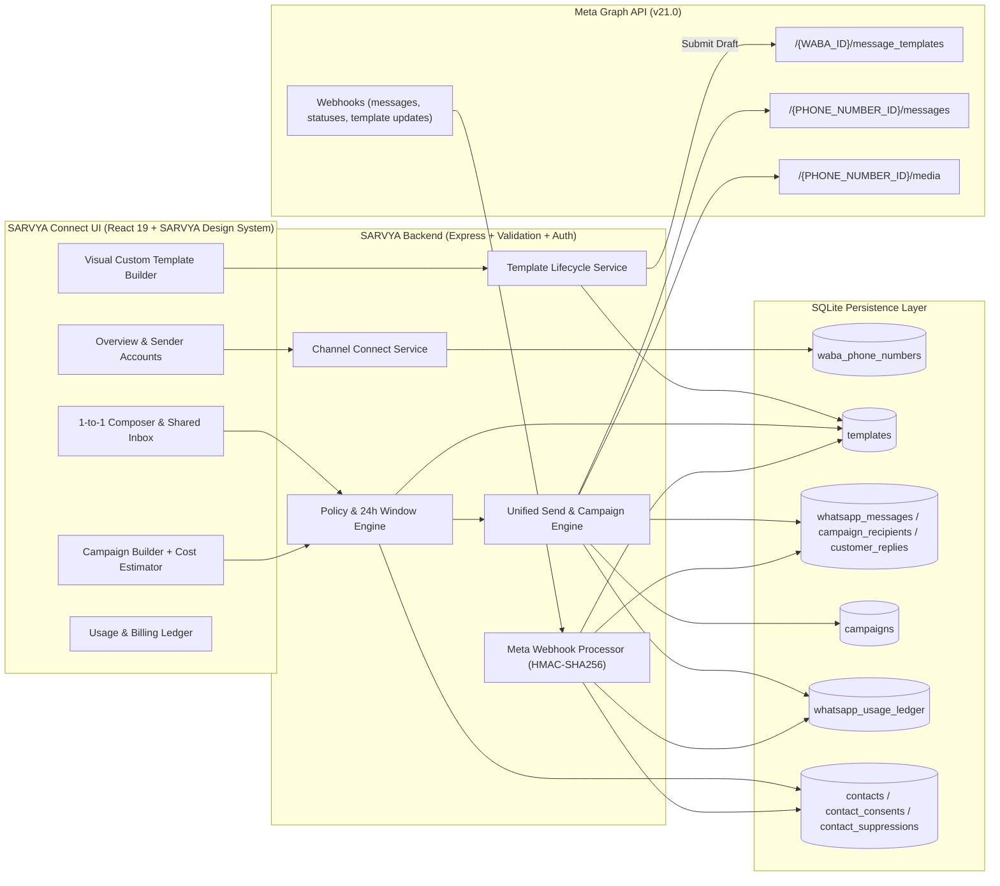

# SARVYA Connect — Implementation-Level PRD & Architecture Specification

**Module**: `SARVYA Connect` (WhatsApp Cloud API Campaign, Custom Template Management, Messaging Governance & Billing)  
**Platform Ecosystem**: `SARVYA Core · SARVYA CRM · SARVYA Forms · SARVYA Flow · SARVYA Connect · SARVYA AI · SARVYA Insights`  
**Status**: Production Specification & Implementation Blueprint  

---

## 1. Executive Vision & Product Scope

**SARVYA Connect** eliminates external WhatsApp Web or third-party broadcast utilities by providing a unified, policy-enforced WhatsApp Business Cloud API engine inside SARVYA. A tenant connects their registered WhatsApp Business sender account once, builds and submits custom Meta message templates directly in the platform, manages opted-in audiences, and executes:

1. **One-to-One Messaging** (session replies inside 24h window or template-initiated outreach outside 24h)
2. **Bulk Broadcast Campaigns** (CSV/Excel/CRM audiences with pre-launch cost estimation, pause/resume/cancel, and real-time SSE progress)
3. **Workflow Triggers** (scheduled reminders, CRM stage transitions, booking milestones)
4. **WhatsApp Flows** (native interactive multi-screen JSON forms)
5. **Scheduled Messages & Campaigns** (cron-backed future dispatch in tenant timezone)

---

## 2. End-to-End System Architecture



---

## 3. SARVYA Connect Module Map & Navigation Structure

| Sub-Module | Route / Tab Key | Core Responsibilities |
| :--- | :--- | :--- |
| **Overview & Accounts** | `overview` | Active sender card (Business Name, Phone Number, Quality Rating, WABA ID), template status counts, message volume, 5 messaging mode quick-launchers, connect/verify new WABA sender |
| **Template Manager** | `templates` | Visual Custom Template Builder, live WhatsApp handset preview, Draft vs. Approved isolation, Submit to Meta, Sync from Meta, filter by status (`APPROVED`, `PENDING`, `DRAFT`, `REJECTED`, `PAUSED`) and category |
| **One-to-One Messaging** | `compose` | Direct contact send with live 24h customer-service window indicator; auto-enforces template requirement when >24h since last inbound reply |
| **Campaign Manager** | `campaigns` | Audience import, template variable mapping, pre-launch opt-out/compliance check, Meta category cost estimate, launch/pause/resume/cancel |
| **Contact Audience** | `audience` | CRM contact search, consent history, opt-out suppression management |
| **Shared Inbox** | `inbox` | Threaded two-way WhatsApp conversations, media previews, instant reply inside 24h window |
| **Automation Triggers** | `automation` | Automated booking confirmation, pre-arrival reminder, post-stay checkout workflows |
| **WhatsApp Flows** | `flows` | Interactive JSON flow builder, Meta crypto key management, encrypted exchange endpoint |
| **Message Analytics** | `analytics` | Delivery funnel (`Sent -> Delivered -> Read -> Replied -> Failed`), campaign export |
| **Usage & Billing** | `usage` | Estimated vs. recorded spend by category (`MARKETING`, `UTILITY`, `AUTHENTICATION`, `SERVICE`), per-message ledger, configurable Meta INR tariff rates |

---

## 4. Visual Custom Message Template Builder Specification

### 4.1 Supported Fields & Constraints

| Field | Format / Rules | Required | Meta Constraint |
| :--- | :--- | :--- | :--- |
| **Template Name** | `^[a-z0-9_]+$` (lowercase alphanumeric + underscores, max 512 chars) | Yes | Immutable once submitted to Meta |
| **Category** | `MARKETING`, `UTILITY`, `AUTHENTICATION` | Yes | Governs billing tariff and Meta review rules |
| **Language** | BCP-47 / Meta locale (`en`, `en_US`, `hi`, `mr`, etc.) | Yes | Must match Meta-approved language pack |
| **Header Type** | `NONE`, `TEXT`, `IMAGE`, `VIDEO`, `DOCUMENT` | No | `TEXT` max 60 chars; media headers support sample media handle/URL |
| **Body Text** | Plain/WhatsApp-formatted text (`*bold*`, `_italic_`) with `{{1}}..{{n}}` or `{{named}}` placeholders | Yes | Max 1024 chars; every variable requires a non-empty sample value before Meta submission |
| **Variable Samples** | Array/map of sample strings corresponding to each `{{n}}` | Conditional | Required by Meta Graph API for template review |
| **Footer Text** | Plain text footer (e.g. opt-out hint) | No | Max 60 chars; no variables allowed |
| **Interactive Buttons** | Up to 3 buttons: `QUICK_REPLY` (text), `URL` (text + url), `PHONE_NUMBER` (text + phone_number), `FLOW` | No | Quick replies max 25 chars; valid https URLs required for `URL` buttons |

### 4.2 Draft vs. Approved State Behavior

- **`DRAFT`**: Editable via `PUT /api/v1/whatsapp/templates/:id`; live preview updates on edit; cannot be dispatched to live recipients.
- **`PENDING` / `IN_REVIEW`**: Read-only in editor after `POST /api/v1/whatsapp/templates/:id/submit`; awaiting Meta review webhook or manual sync.
- **`APPROVED`**: Read-only lock enforced by backend (`409 Conflict` if `PUT` attempted); must duplicate/clone into a new versioned draft to modify content; selectable across One-to-One, Bulk Campaigns, and Workflows.
- **`REJECTED` / `PAUSED`**: Displays Meta `rejection_reason`; editable for re-submission (`DRAFT`/`REJECTED` -> fix -> resubmit); blocked from live message dispatches.

---

## 5. Relational Database Schema (SQLite)

### 5.1 Core Tables Added / Extended in `src/config/database.js`

#### `templates` (Extended)
- Existing columns: `id`, `name`, `meta_id`, `language`, `category`, `status`, `parameter_format`, `body_text`, `variables`, `components`, `buttons`, `created_at`, `updated_at`
- Added columns (idempotent `ALTER TABLE`):
  - `header_type TEXT DEFAULT 'NONE'` (`NONE | TEXT | IMAGE | VIDEO | DOCUMENT`)
  - `header_text TEXT`
  - `header_media_url TEXT`
  - `footer_text TEXT`
  - `rejection_reason TEXT`
  - `version INTEGER DEFAULT 1`
  - `submitted_at DATETIME`
  - `approved_at DATETIME`
  - `user_id TEXT`
  - `tenant_id INTEGER DEFAULT 1`

#### `whatsapp_messages` (Unified Outbound & Status Ledger for 1-to-1 & Campaigns)
```sql
CREATE TABLE IF NOT EXISTS whatsapp_messages (
  id TEXT PRIMARY KEY,
  tenant_id INTEGER DEFAULT 1,
  user_id TEXT,
  phone_number_id TEXT,
  campaign_id TEXT,
  recipient_phone TEXT NOT NULL,
  direction TEXT DEFAULT 'OUTBOUND', -- OUTBOUND | INBOUND
  message_type TEXT NOT NULL,        -- TEMPLATE | TEXT | MEDIA | FLOW
  template_id TEXT,
  template_name TEXT,
  template_category TEXT,
  message_body TEXT,
  components_json TEXT,
  status TEXT DEFAULT 'SENT',        -- QUEUED | SENT | DELIVERED | READ | FAILED
  meta_message_id TEXT,
  error_code TEXT,
  error_message TEXT,
  estimated_cost REAL DEFAULT 0,
  currency TEXT DEFAULT 'INR',
  created_at DATETIME DEFAULT CURRENT_TIMESTAMP,
  updated_at DATETIME DEFAULT CURRENT_TIMESTAMP,
  delivered_at DATETIME,
  read_at DATETIME,
  failed_at DATETIME
);
```

#### `whatsapp_usage_ledger` (Cost Accounting & Billing Estimation)
```sql
CREATE TABLE IF NOT EXISTS whatsapp_usage_ledger (
  id INTEGER PRIMARY KEY AUTOINCREMENT,
  tenant_id INTEGER DEFAULT 1,
  user_id TEXT,
  phone_number_id TEXT,
  campaign_id TEXT,
  message_id TEXT,
  meta_message_id TEXT,
  recipient_phone TEXT,
  category TEXT DEFAULT 'MARKETING', -- MARKETING | UTILITY | AUTHENTICATION | SERVICE
  unit_cost REAL DEFAULT 0,
  currency TEXT DEFAULT 'INR',
  billing_status TEXT DEFAULT 'ESTIMATED', -- ESTIMATED | RECORDED | WAIVED
  created_at DATETIME DEFAULT CURRENT_TIMESTAMP
);
```

---

## 6. Meta Cloud API & Backend `/api/v1/*` Contracts

### 6.1 Meta Graph API Operations (`v21.0`)

| Capability | Meta Endpoint | Method | Notes |
| :--- | :--- | :--- | :--- |
| Verify Sender Number | `/{PHONE_NUMBER_ID}?fields=id,display_phone_number,verified_name,quality_rating,code_verification_status,status` | `GET` | Validates token and fetches quality/verification |
| Subscribe App Webhooks | `/{WABA_ID}/subscribed_apps` | `POST` | Optional during onboarding |
| Create/Submit Template | `/{WABA_ID}/message_templates` | `POST` | Sends `name`, `category`, `language`, `components` (`HEADER`, `BODY`, `FOOTER`, `BUTTONS`) with examples |
| Sync Templates | `/{WABA_ID}/message_templates?fields=id,name,status,category,language,components,parameter_format,rejected_reason` | `GET` | Updates local `templates` status & rejection reason |
| Send Message | `/{PHONE_NUMBER_ID}/messages` | `POST` | Dispatches `template`, `text`, `image/document/video`, or `interactive` |

### 6.2 SARVYA Connect REST API (`/api/v1/*`)

| Method | Endpoint | Description |
| :--- | :--- | :--- |
| `POST` | `/api/v1/channels/whatsapp/connect` | Connects or verifies a registered WABA Phone Number (`displayName`, `phoneNumber`, `phoneNumberId`, `wabaId`, `accessToken?`, `isDefault`) |
| `GET` | `/api/v1/channels/whatsapp/accounts` | Lists all connected WhatsApp sender accounts + default active account + health summary |
| `POST` | `/api/v1/whatsapp/templates` | Creates a custom WhatsApp template draft (`DRAFT`) or stores metadata locally |
| `PUT` | `/api/v1/whatsapp/templates/:id` | Updates a editable template (`DRAFT` or `REJECTED`); rejects `409 Conflict` for `APPROVED`/`PENDING` |
| `POST` | `/api/v1/whatsapp/templates/:id/submit` | Validates placeholders/sample examples and submits template to Meta `/{WABA_ID}/message_templates`, transitioning state to `PENDING` (or Meta-returned initial status) |
| `GET` | `/api/v1/whatsapp/templates` | Lists templates with status breakdown (`approved`, `pending`, `draft`, `rejected`, `paused`), filters (`status`, `category`, `search`), and optional `?sync=true` |
| `POST` | `/api/v1/whatsapp/messages/send` | Sends 1-to-1 message (`TEMPLATE` or `TEXT`/`MEDIA`); enforces opt-out suppression, approved-only templates, and 24-hour window rule |
| `POST` | `/api/v1/whatsapp/campaigns` | Creates campaign, evaluates suppression/invalid contacts, returns recipient breakdown & estimated cost |
| `POST` | `/api/v1/whatsapp/campaigns/:id/launch` | Validates template approval & launch readiness, then starts or queues campaign execution |
| `GET` | `/api/v1/whatsapp/messages/:id` | Retrieves unified message record by local `id` or `meta_message_id` (checks `whatsapp_messages` and `campaign_recipients`) |
| `GET` | `/api/v1/whatsapp/usage` | Returns usage counters, category spend breakdown, tariff rates, and recent ledger entries |
| `POST` | `/api/v1/webhooks/meta/whatsapp` | Receives Meta inbound messages, delivery status callbacks (`sent`, `delivered`, `read`, `failed`), and template approval status updates (`message_template_status_update`) |
| `GET` | `/api/v1/webhooks/meta/whatsapp` | Handles Meta `hub.challenge` webhook verification handshake |

---

## 7. State Machines

### 7.1 Template State Machine
```
[DRAFT] --(submit to Meta)--> [PENDING] --(Meta webhook / sync)--> [APPROVED] (Locked for editing; ready to send)
   ^                             |                                    |
   |                             +--(Meta rejects)--> [REJECTED]      +--(Meta quality issue)--> [PAUSED]
   +-----------(edit draft / clone from APPROVED/REJECTED)------------+
```

### 7.2 Campaign State Machine
```
[DRAFT / SCHEDULED] --(launch / scheduler)--> [RUNNING] --(all recipients attempted)--> [COMPLETED]
                                                 |  ^
                                       (pause)   v  | (resume)
                                              [PAUSED]
                                                 |
                                       (cancel)  v
                                            [CANCELLED]
```

---

## 8. Messaging Policy Enforcement Matrix & Billing Formula

### 8.1 Outbound Validation Rules (Strictly Enforced Server-Side)

| Scenario | Free-Form Text / Media | Approved Template (`APPROVED`) | Non-Approved Template (`DRAFT` / `PENDING` / `REJECTED` / `PAUSED`) |
| :--- | :--- | :--- | :--- |
| **Opted-Out / Suppressed Contact** | **403 Blocked** (`CONTACT_OPTED_OUT`) unless explicit service override disabled | **403 Blocked** (`CONTACT_OPTED_OUT`) in campaigns & marketing 1-to-1 | **400/403 Blocked** |
| **Within 24h Since Last Inbound Msg** | **Allowed** (`SERVICE` conversation) | **Allowed** (Category rate applies) | **400 Blocked** (`TEMPLATE_NOT_APPROVED`) |
| **Outside 24h / Never Replied** | **422 Blocked** (`WINDOW_CLOSED_24H`) — requires approved template | **Allowed** | **400 Blocked** (`TEMPLATE_NOT_APPROVED`) |
| **Missing Sample / Variable Values** | Validated non-empty body | **400 Blocked** (`MISSING_TEMPLATE_PARAMS`) | **400 Blocked** |

### 8.2 Configurable Meta Category Cost Estimation (Default INR Tariff)
- `MARKETING`: Configurable `META_MARKETING_RATE_INR` (default `0.80 INR` / delivered conversation)
- `UTILITY`: Configurable `META_UTILITY_RATE_INR` (default `0.12 INR` / delivered conversation)
- `AUTHENTICATION`: Configurable `META_AUTH_RATE_INR` (default `0.12 INR` / delivered conversation)
- `SERVICE` (Free-form reply inside 24h customer-service window): `0.00 INR`

**Pre-Launch Formula**:  
$$\text{EstimatedTotal} = \text{EligibleRecipientCount} \times \text{CategoryUnitRate}$$

---

## 9. Acceptance Criteria & Automated Test Coverage

1. **Sender Connection**: Connecting an account validates phone details, persists into `waba_phone_numbers`, and surfaces under `/api/v1/channels/whatsapp/accounts`.
2. **Template Draft & Lock**: Creating a draft saves editable `DRAFT`; `APPROVED` templates return `409 Conflict` when edited directly (`PUT`).
3. **Meta Submission Guard**: Submitting a template with unresolved `{{1}}` sample values fails `400`; valid draft submits to `/{WABA_ID}/message_templates` and updates status cleanly.
4. **24h Window Rule**: Sending a `TEXT` message to a recipient with no inbound reply in the past 24 hours returns `422 WINDOW_CLOSED_24H`; after recording an inbound reply (or webhook message), `TEXT` send succeeds.
5. **Opt-Out Suppression**: Sending 1-to-1 or launching a campaign suppresses/blocks opted-out phone numbers (`contact_suppressions`).
6. **Approved Template Gate**: Attempting `POST /api/v1/whatsapp/messages/send` or `POST /api/v1/whatsapp/campaigns/:id/launch` with a `DRAFT`, `PENDING`, or `REJECTED` template returns `400 TEMPLATE_NOT_APPROVED`.
7. **Status & Usage Ledger**: Sent messages create rows in `whatsapp_messages` and `whatsapp_usage_ledger`, queryable via `GET /api/v1/whatsapp/messages/:id` and `GET /api/v1/whatsapp/usage`, and status webhooks (`delivered`, `read`, `failed`) update timestamps and counts.

