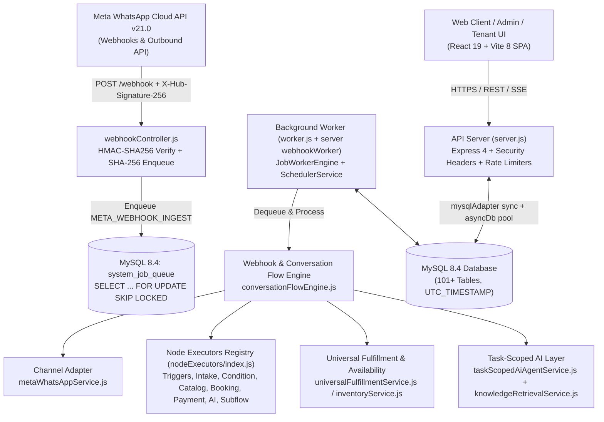

# SARVYA — System Architecture

## 1. Runtime Topology

---

## 2. Backend Module Layout (`src/`)

- **`src/config/`**: `env.js` (environment & fail-closed production secret enforcement), `database.js` (settings encryption wrapper + initialization), `mysqlAdapter.js` (sync worker-thread MySQL bridge for legacy synchronous queries), `asyncDb.js` (`mysql2/promise` pool for transactional/locking async workers), `schema.js` (101 canonical tables + idempotent migrations & seeds).
- **`src/middleware/`**: `authMiddleware.js` (JWT verification, workspace resolution, RBAC), `rateLimiter.js` (tiered per-route IP/user limiters), `securityHeaders.js` (CSP, HSTS/frame/nosniff headers), `uploadMiddleware.js`.
- **`src/controllers/` & `src/routes/`**: Domain-separated HTTP layers for Auth, Admin Governance, Agency Workspaces, Billing, Campaigns/Broadcast, CRM Pipelines, Universal Catalog & Masters, Hospitality Inventory, In-App Studio & Runtime, Chat Links, Payouts, Reports, Webhooks, and Conversation Flows.
- **`src/modules/templateLibrary/`**: Reusable template catalog, immutable releases (`template_versions`), client installations (`template_installations`), resource bindings (`template_bindings`), schema validator (`templateConfigValidator`), and upgrade merger (`templateUpgradeService`).
- **`src/services/workflow/`**: Pluggable node executors (`nodeExecutors/*`), zero-eval `expressionEvaluator.js`, compiled O(1) `workflowTriggerService.js`, `conversationContextResolver.js`, `flowAnalyticsService.js`, and AI Flow Architect (`aiFlowGeneratorService.js`).
- **`src/services/queue/`**: MySQL 8.4 transactional job queue (`jobQueueService.js`) and worker pool (`jobWorkerEngine.js`).

---

## 3. Frontend Module Layout (`frontend/src/`)

- **Core Shell**: `App.jsx`, `Sidebar.jsx`, `Topbar.jsx`, `PageSystem.jsx` (lazy-loaded code-split routes via `lazyWithRetry.js`), `context/AuthProvider.jsx`.
- **Design System**: `index.css` CSS tokens & `@layer` cascade, reusable accessible primitives in `components/ui/` (`DataTable.jsx`, `Modal.jsx` native `<dialog>`, `Tabs.jsx`, `Drawer.jsx`, `ChartCard.jsx`, `Primitives.jsx`).
- **Operational Pages**: Dashboard, CRM Enquiries, Consolidated Flow Builder (`FlowBuilderPage.jsx`), Enterprise Automation Studio (`features/automation/`), Conversations Inbox, Broadcast Studio, Chat Links, Catalog & Masters Hub, Orders & Bookings, Hospitality Calendar, Insights/Reports, Settings, and Admin Panels.
