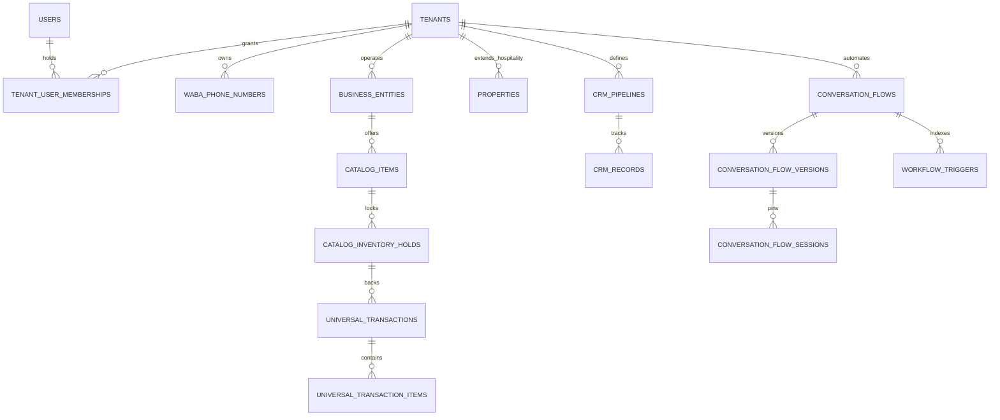

# SURVYA — Canonical Data Model

> Grounded in `src/config/schema.js` (**109** `TABLE_SCHEMAS` tables). Zero existing tables or columns containing historical data are dropped; migrations follow expand-migrate-contract.

---

## 1. Domain Entity Relationship Overview

---

## 2. Store Rationalization Decisions (Preserving History)

| Domain Concept | Coexisting Tables | Authoritative Source of Truth | Legacy Handling Decision |
|---|---|---|---|
| **Catalog & Pricing** | `catalog_items` (universal + legacy cols), `room_types` | `catalog_items` + `master_tax_slabs` + `catalog_pricing_rules` (`universalCatalogService`, `universalPricingService`) | `room_types` remains the Hospitality domain extension linked by `(tenant_id, property_id)` and synced cleanly with `catalog_items` for omnichannel bookings |
| **Inventory & Holds** | `catalog_inventory_holds`, `daily_inventory_matrix`, `catalog_availability_slots`, `room_inventory_daily` | `catalog_inventory_holds` via `universalAvailabilityService` (`createInventoryHold` / `confirmHold` / `releaseHold`) | Legacy `captureOrderPayment` and `hospitalityAvailabilityService` must validate & synchronize with canonical availability/holds cleanly |
| **Bookings & Orders** | `universal_transactions` (+ `items`), `unified_orders` (+ `items`), `booking_enquiries` + `quotes` | `universal_transactions` (`universalFulfillmentService`) | Keep `unified_orders`, `booking_enquiries`, and `quotes` intact & readable for historical reconciliation; no split-brain independent stock mutation |
| **CRM & Enquiries** | `crm_pipelines`, `crm_records`, `booking_enquiries`, `enquiries` | `crm_records` via `crmPipelineService` (`BOOKING` / `LEAD_GEN` / `B2B_SALES` stages) | `booking_enquiries` serves Hospitality enquiry workflows; `enquiries` table (broken write path) is **deprecated read-only legacy** |
| **Merchant Payments** | `merchant_payment_configs`, `merchant_payout_beneficiaries`, `merchant_payout_ledger` | `merchant_payment_configs` + `universal_transactions` (Merchant-Direct Webhook Verification) | `merchant_payout_beneficiaries` & `merchant_payout_ledger` frozen for historical read-only auditability (zero new simulated PA/PG fee or mock IMPS settlements) |
| **Channel Credentials** | `settings`, `waba_phone_numbers` | `waba_phone_numbers.access_token_enc` (per-line encrypted) + `settings` (`META_APP_SECRET` / `WEBHOOK_VERIFY_TOKEN` decrypted) | Eliminate plaintext `access_token` leakage in API responses; never allow `tenant_id > 1` fallback to Tenant 1 global tokens |

---

## 3. Core Schema Integrity Fixes Planned (`schema.js`)

1. Remove redundant duplicate `CREATE TABLE IF NOT EXISTS flow_global_settings` inside `runColumnMigrations` (`L448`).
2. Add missing composite indexes (`booking_enquiries(tenant_id, property_id, status)`, `customer_replies(tenant_id, from_phone(64), received_at)`, `templates(tenant_id, name(128), language(32))`).
3. Replace static `"wb_verify_konkantrip_7f3a9e2c4b810d56"` fresh-install verify token default with cryptographically random `"wb_verify_<randomHex>"`.
4. Ensure index creation logs non-benign SQL failures rather than silently ignoring all errors.
