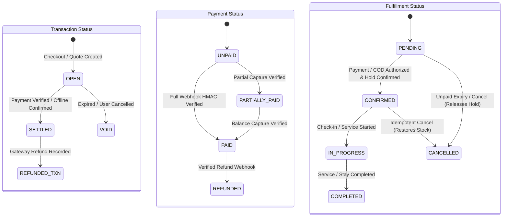
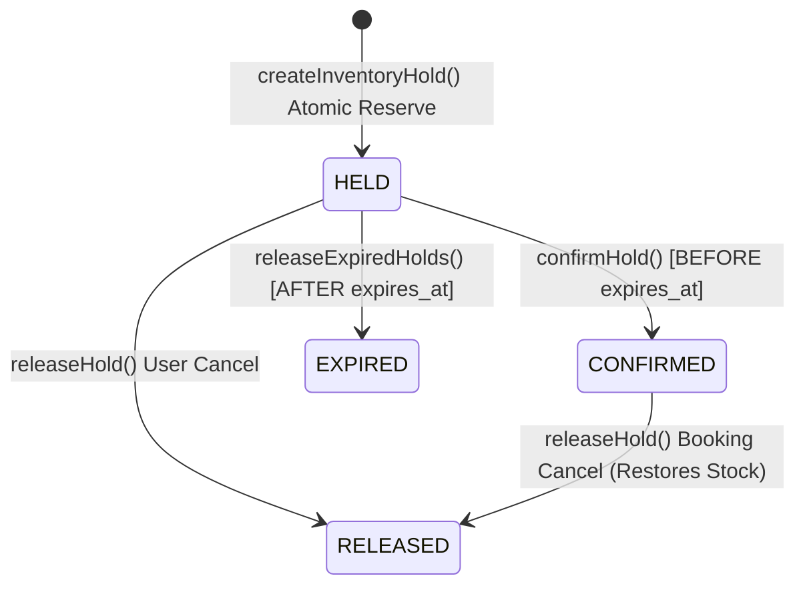
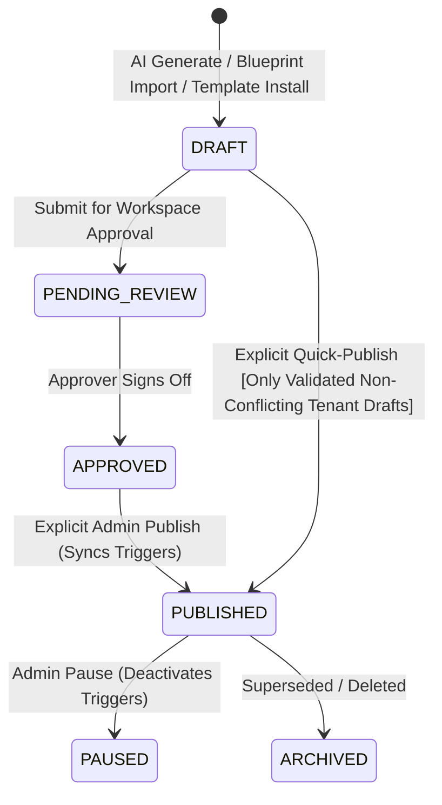

# SURVYA — Canonical Entity State Transitions

> Every commercial transaction, inventory hold, payment status, CRM deal, and workflow session uses explicit, non-overlapping state machines. Payment success never infers from UI state; inventory holds fail closed on expiry.

---

## 1. Universal Transaction (`universal_transactions`) State Machines

## 2. Inventory Hold (`catalog_inventory_holds`)

- **Fail-Closed Rule:** Any `confirmHold()` or `reconcilePaymentSuccess()` encountering `status IN ('EXPIRED','CANCELLED','RELEASED')` or `expires_at <= UTC_TIMESTAMP()` MUST reject confirmation with `409 Conflict` unless explicit re-availability check re-acquires stock atomically.

## 3. CRM Record Stage (`crm_records`) & Lead Status Mapping

- **`stage_key`** always stores the canonical uppercase key defined by its parent `crm_pipelines.stages_json` (e.g. `NEW_LEAD`, `MQL`, `SQL`, `DEMO_BOOKED`, `PROPOSAL_SENT`, `WON`, `LOST` or booking stages `INQUIRY`, `AVAILABILITY_CHECKED`, `QUOTED`, `PAYMENT_PENDING`, `CONFIRMED`, `COMPLETED`, `CANCELLED`).
- Derived `status`:
  - `WON`: `stage_key IN ('WON', 'CLOSED_WON', 'CONFIRMED', 'CONVERTED', 'COMPLETED')`
  - `LOST`: `stage_key IN ('LOST', 'CLOSED_LOST', 'CANCELLED', 'UNQUALIFIED')`
  - `ACTIVE`: all earlier pipeline stages.

## 4. Workflow Definition & Installation Lifecycle

