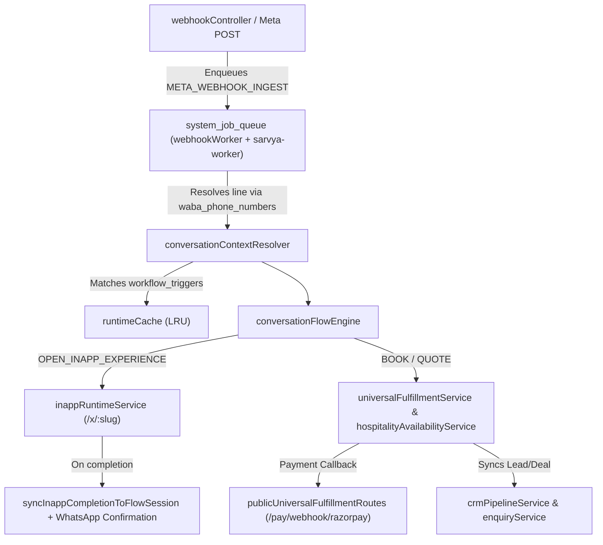

# SURVYA — Module Dependency Map (Baseline @ `59e71f5`)

> Maps Frontend Pages -> API Routes -> Controllers -> Services -> Persistence Tables & Cross-Module Dependencies verified directly from `d:\whatsapp_bulk`.

---

## 1. Frontend-to-Backend Dependency Matrix

| Route Key (`PageSystem`) | Frontend Module | Backend Route(s) | Controller(s) | Core Service(s) | Primary DB Tables |
|---|---|---|---|---|---|
| `dashboard` | `DashboardPage.jsx` | `/api/v1/dashboard/summary`, `/api/reports/overview`, `/api/analytics/summary` | `hospitalityController` / `resortController`, `reportsController` | `enquiryService`, `reportsController` SQL, `paymentPayoutService` | `booking_enquiries`, `quotes`, `universal_transactions`, `unified_orders`, `campaigns` |
| `inbox` | `InboxPage.jsx` | `/api/replies/*`, `/api/inbox/*`, `/api/broadcast/stream` | `webhookController`, `aiAssistantController`, `adminController` | `webhookService`, `inboxCopilotService`, `broadcastEngine` | `customer_replies`, `conversation_handoff_states`, `campaigns`, `ai_interaction_logs` |
| `enquiries` | `EnquiriesPage.jsx` | `/api/enquiries/*`, `/api/v1/crm/*`, `/api/contacts` | `resortController`, `crmPipelineController` | `enquiryService`, `crmPipelineService`, `quotationService` | `booking_enquiries`, `quotes`, `quote_items`, `crm_pipelines`, `crm_records`, `contacts` |
| `transactions` | `BookingsOrdersPage.jsx` | `/api/v1/fulfillment/*`, `/api/v1/transactions/*`, `/api/v1/orders/*` | `universalFulfillmentRoutes`, `unifiedOrderController` | `universalFulfillmentService`, `universalAvailabilityService`, `unifiedOrderService`, `paymentPayoutService` | `universal_transactions`, `universal_transaction_items`, `catalog_inventory_holds`, `unified_orders` |
| `catalog` | `CatalogInventoryPage.jsx` | `/api/v1/entities/*`, `/api/v1/universal/*` | `catalogController`, `universalCatalogController` | `universalCatalogService`, `universalAvailabilityService`, `universalPricingService` | `business_entities`, `catalog_categories`, `catalog_items`, `catalog_addons`, `catalog_availability_slots`, `daily_inventory_matrix` |
| `inventory` | `InventoryCalendarPage.jsx` | `/api/v1/hospitality/*` | `hospitalityController` | `hospitalityConfigService`, `hospitalityAvailabilityService`, `hospitalityPricingService` | `properties`, `room_types`, `room_inventory_daily`, `hospitality_daily_rates`, `hospitality_seasonal_rates`, `hospitality_rate_plans`, `hospitality_tax_rules`, `hospitality_inventory_blocks` |
| `masters` | `MastersHubPage.jsx` | `/api/v1/masters/*`, `/api/v1/universal/blueprints/*` | `masterRoutes`, `universalCatalogController` | `masterDataService`, `masterCacheService`, `universalCatalogService` | `master_domain_profiles`, `master_locations`, `master_categories`, `master_units`, `master_tax_slabs`, `master_attributes`, `master_resources` |
| `domain_hub` | `DomainWorkspacePage.jsx` | `/api/v1/studio/domain-access/*` | `studioController` | `domainProfileService`, `studioExperienceService`, `universalCatalogService` | `tenants`, `master_domain_profiles`, `inapp_experiences`, `conversation_flows` |
| `flows` / `automation` | `FlowBuilderPage.jsx` | `/api/flows/conversation-flows/*`, `/api/v1/flow-preview/*` | `conversationFlowController`, `flowApprovalController`, `flowPreviewController` | `conversationFlowService`, `conversationFlowEngine`, `workflowTriggerService`, `flowApprovalService` | `conversation_flows`, `conversation_flow_versions`, `workflow_triggers`, `conversation_flow_sessions`, `flow_global_settings`, `flow_approval_requests` |
| `inapp_studio` / `/x/:slug` | `InAppStudioPage.jsx`, `PublicExperiencePage.jsx` | `/api/v1/inapp/*`, `/api/v1/studio/*`, `/api/v1/public/x/*` | `inappExperienceController`, `studioController`, `inappRuntimeController` | `inappRuntimeService`, `continuationTokenService`, `businessGoalService`, `emailNotificationService`, `studioAnalyticsService` | `inapp_experiences`, `inapp_screens`, `inapp_form_fields`, `inapp_sessions`, `experience_continuation_tokens`, `business_goal_outcomes`, `email_notification_logs` |
| `autoreply` / `flowStudio` | `AutomationStudio.jsx` | `/api/v1/template-library/*`, `/api/v1/template-installations/*` | `templateController` (`templateLibrary`) | `templateRepository`, `templateInstallService`, `templateUpgradeService`, `templateBindingService`, `templateGovernanceService` | `template_catalog`, `template_versions`, `template_installations`, `template_bindings`, `conversation_flows` |
| `connect` | `SarvyaConnectPage.jsx` | `/api/phone-numbers/*`, `/api/templates/*`, `/api/meta/*` | `adminController`, `settingsController`, `sarvyaConnectController`, `templateController` | `metaWhatsAppService`, `metaEmbeddedSignupService`, `whatsappMessagingService` | `waba_phone_numbers`, `templates`, `settings`, `whatsapp_usage_ledger` |
| `broadcast` | `BroadcastPage.jsx` | `/api/campaigns/*`, `/api/broadcast/*` | `broadcastController`, `campaignController` | `broadcastService`, `broadcastEngine`, `whatsappMessagingService`, `billingService` | `campaigns`, `broadcast_recipients`, `whatsapp_messages`, `contact_consents` |
| `links` / `/c/:slug` | `ChatLinksPage.jsx`, `PublicChatLandingPage.jsx` | `/api/chat-links/*`, `/api/public/chat/*` | `chatLinkController` | `chatLinkService`, `hospitalityFlowEngine`, `hospitalityChatService` | `chat_links`, `customer_replies`, `hospitality_chat_sessions` |
| `ai` | `AiAssistantPage.jsx` | `/api/ai/*`, `/api/v1/ai/*` | `aiAssistantController` | `taskScopedAiAgentService`, `knowledgeRetrievalService`, `aiFlowGeneratorService` | `ai_agent_configs`, `ai_knowledge_sources`, `ai_interaction_logs`, `ai_usage_ledger` |
| `settings` | `SettingsPage.jsx` | `/api/auth/*`, `/api/v1/workspace/users/*`, `/api/settings/*`, `/api/v1/billing/*` | `authController`, `workspaceTeamController`, `settingsController`, `billingController` | `billingService`, `webhookService` | `users`, `tenants`, `tenant_user_memberships`, `tenant_settings`, `settings`, `billing_invoices` |
| `admin` / `payouts` | `SystemAdminPanel.jsx`, `PayoutsPage.jsx` | `/api/admin/*`, `/api/payouts/*`, `/api/v1/jobs/*` | `adminController`, `payoutController`, `jobQueueRoutes` | `recycleBinService`, `paymentPayoutService`, `jobQueueService` | `audit_logs`, `system_job_queue`, `incoming_webhook_events`, `merchant_payment_configs`, `merchant_payout_ledger` |

---

## 2. Critical Cross-Module Coupling Diagram

